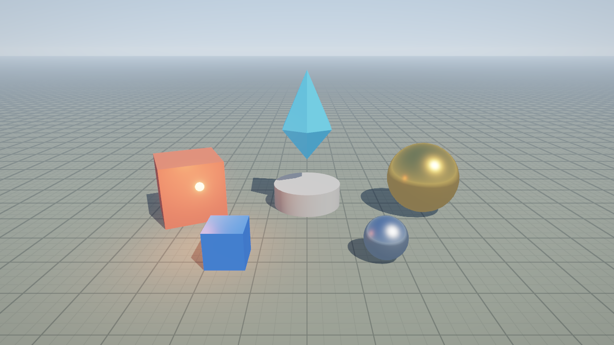
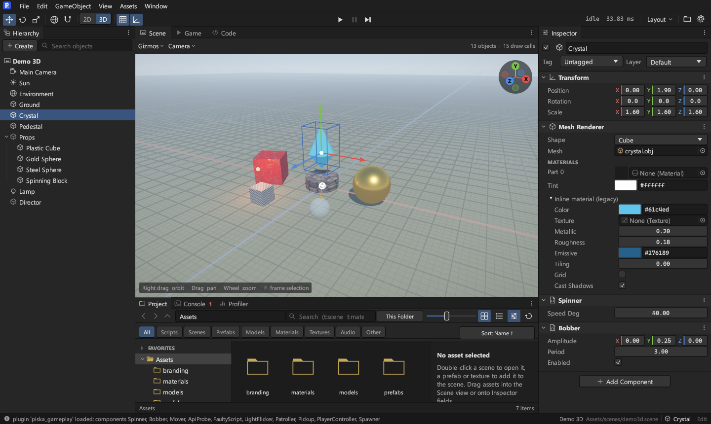
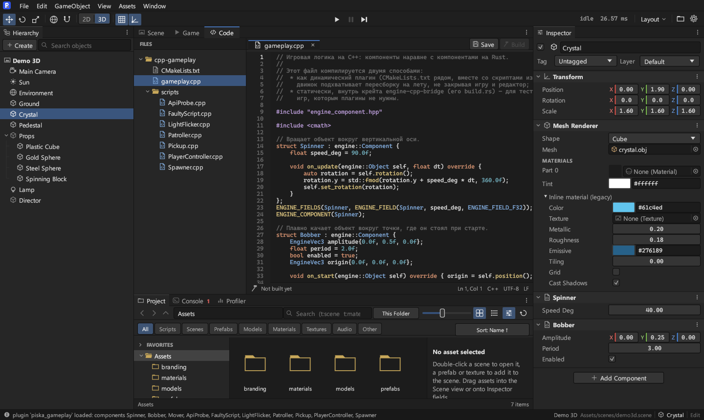
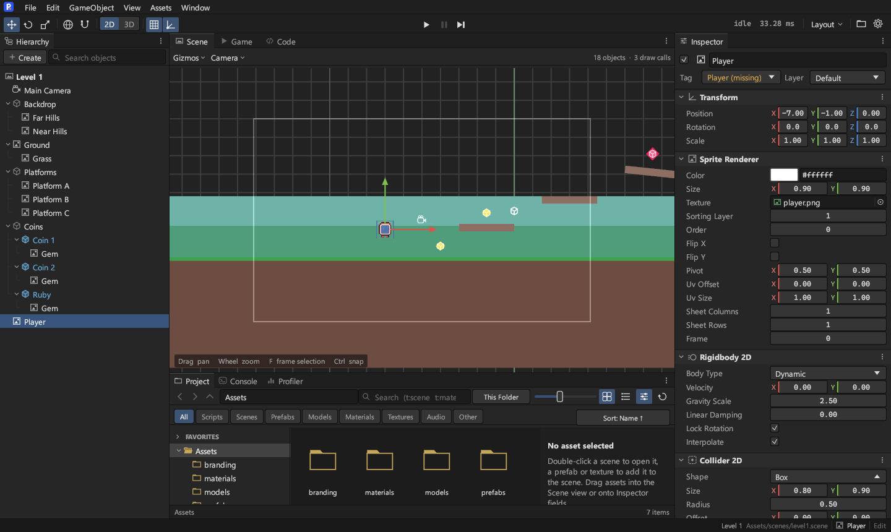
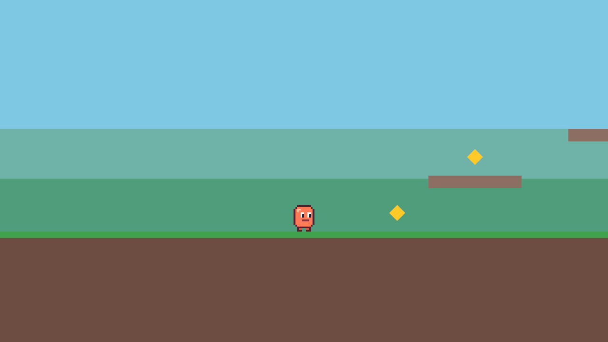
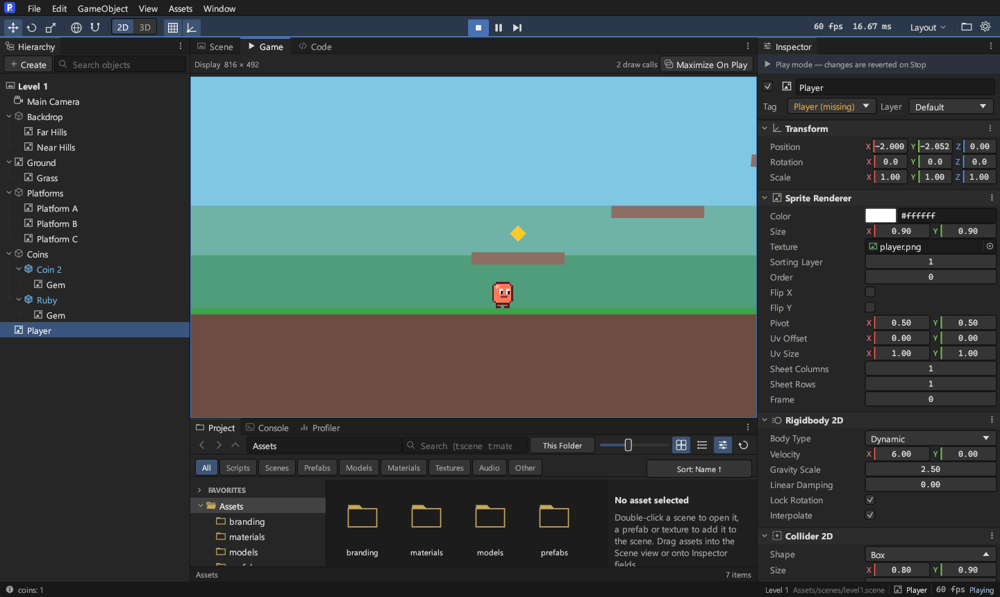

# Piska Engine — игровой движок в стиле Unity на Rust + C++

Название — **Piska Engine**. Документ описывает и проект целиком, и то, что
уже работает в этом репозитории. Всё, что помечено ✅, собрано и покрыто тестами;
всё, что помечено ◻, — план, и код в таких разделах — целевой API, а не рабочий.

| | Состояние |
|---|---|
| ✅ `engine-core` | GameObject/Component, иерархия, жизненный цикл, сообщения, события, reflection, сцены и префабы в RON, ввод, главный цикл с фиксированным шагом и сглаживанием |
| ✅ `engine-assets` | `.meta`-файлы, GUID, `AssetHandle<T>`, база ассетов, импорт мешей `.obj` / `.gltf` / `.glb` |
| ✅ `engine-render` | 2D: спрайты, батчинг, слои сортировки. 3D: меши с PBR, солнце с тенями, точечный свет, небо, туман, MSAA, HDR с блумом и ACES. Камеры, окно, захват кадра без окна |
| ✅ `engine-physics` | 2D: Rapier2D, Rigidbody2D/Collider2D, триггеры, слои, raycast, односторонние платформы. 3D: Rapier3D, Rigidbody/Collider, суставы, лучи, взрывной импульс, контроллер персонажа. Сглаживание поз между шагами |
| ✅ `engine-cpp-bridge` | логика игр на C++: компоненты с хуками и полями через C ABI, горячая перезагрузка плагина; статические C++-модули; заголовок из `cbindgen` |
| ✅ `engine-editor` | редактор на egui + wgpu: Hierarchy, Inspector из reflection, Scene (2D и 3D) / Game с гизмо, редактор кода со сборкой, Project, Console, Profiler, Play/Pause/Step, Undo — см. [раздел 15](#15-редактор) |
| ✅ `engine` | фасад, примеры `hello_sprite`, `hello_3d`, `physics3d`, `platformer`, `editor`, `demo3d`, `cpp_plugin` |
| ◻ аудио, геймпад, анимация, тайлмапы | см. [план](#12-план-реализации) |

Языки компонентов — **Rust и C++**: компонент на Rust — это `impl Component`, компонент на
C++ — класс в плагине (раздел 16). Поверх компонентов есть свой маленький язык сценариев
**Scenario** (крейт `engine-scenario`, без сторонних интерпретаторов): синтаксис Lua и
JavaScript в одном файле, байткод и возобновляемая ВМ — каждый сценарий это сопрограмма, которая
может ждать (`wait`, `move_to`, `wait_message`) посреди вложенных вызовов; бюджет инструкций на
кадр не даёт зациклившемуся сценарию повесить игру или редактор. Ядро языка не зависит от движка
и собирается под wasm32; связь с движком — модуль `engine::scenario` (компонент
`ScenarioRunner`, подсистема, горячая перезагрузка `.scenario` в Play). Сценарии — для катсцен,
обучения, диалогов и событий уровня, а не замена компонентам (`docs/api/scenario.md`).

Запуск:

```bash
cargo test --workspace
cargo run --example hello_sprite
cargo run --example hello_3d
cargo run --example physics3d            # 3D-физика: WASD, пробел, E — взрыв
cargo run --example platformer
cargo run --example editor               # платформер, открытый в редакторе
cmake -S plugins/cpp-gameplay -B plugins/cpp-gameplay/build
cmake --build plugins/cpp-gameplay/build --config Release
cargo run --example demo3d               # 3D-сцена с компонентами на Rust и C++
cargo run --example demo3d -- --editor   # она же в редакторе: 3D-вид, вкладка Code, Build
```

> Windows: линкер MSVC и CMake не открывают файлы с путём длиннее 260 символов. Держите
> проект по короткому пути или задайте `CARGO_TARGET_DIR` (и `-B` у CMake) на короткий каталог.

Проверено на Windows 11 (MSVC, Vulkan): 75 тестов и ещё 3, которым нужны GPU и
компилятор C++ (снимки редактора; правка C++ → сборка → перезагрузка плагина; новый скрипт
из редактора), `cargo clippy` без предупреждений. Linux, macOS и Web не проверялись.

3D-сцена `demo3d` (кристалл — меш из `.obj`, вращают и качают его компоненты на C++),
кадр снят без окна:



Она же в редакторе — 3D-вид с гизмо и вкладка Code с исходником C++-плагина:





2D-платформер в редакторе и сам по себе:





---

## 1. Видение

Piska Engine — это привычная модель Unity (GameObject → компоненты → скрипты с хуками, сцены,
префабы, инспектор), но собранная вокруг трёх решений, которых нет у соседей. **Первое:
проект — это текст.** Сцены, префабы и `.meta` — человекочитаемый RON, который нормально
диффится и мержится, а не YAML с fileID, как у Unity; экземпляр префаба в сцене — это
ссылка плюс список переопределённых полей. **Второе: игра запускается без окна.** Ядро не
знает про GPU, поэтому геймплей тестируется обычным `cargo test` (ввод подаётся
программно, кадр можно снять в PNG на CI) — у Unity и Godot для этого приходится
поднимать сам движок в batch/headless-режиме. **Третье: безопасный Rust без ECS.** В отличие от Bevy здесь нет
запросов, систем и архетипов: скрипт — это структура с методами `on_update`, которая
получает честный `&mut World`; `unsafe` живёт в одном крейте на границе с C++, а C++
подключается как равноправный гражданин через узкий C ABI — для тяжёлых вычислений,
готовых библиотек и плагинов. В отличие от Godot нет собственного языка и наследования
узлов: поведение — это композиция компонентов на одном языке со всем движком.

---

## 2. Структура проекта

```text
.
├── Cargo.toml                     # workspace
├── DESIGN.md
├── docs/                          # скриншоты примеров
├── assets/                        # ассеты примеров
│   ├── scenes/level1.scene        # сцена (RON)
│   ├── prefabs/coin.prefab        # префаб (RON)
│   └── sprites/player.png(.meta)  # текстура + meta с GUID и настройками импорта
├── crates/
│   ├── engine-core/        ✅ #![forbid(unsafe_code)] — без окна и GPU
│   │   ├── src/object.rs          # GameObject, GameObjectId
│   │   ├── src/component.rs       # trait Component (хуки), Ctx, Message
│   │   ├── src/transform.rs       # Transform
│   │   ├── src/scene.rs           # Scene: граф объектов, поиск, иерархия
│   │   ├── src/world.rs           # World, Time, Resources, Events, диспетчер хуков
│   │   ├── src/app.rs             # App: главный цикл, trait Subsystem
│   │   ├── src/reflect.rs         # Value, Reflect, component!, reflect_enum!, TypeRegistry
│   │   ├── src/serialize.rs       # SceneData/NodeData/Override, Prefab, PrefabSource
│   │   ├── src/input.rs           # клавиши, оси и кнопки как в Unity Input Manager
│   │   ├── src/logging.rs         # лог: stderr + буфер в памяти для консоли редактора
│   │   ├── src/error.rs           # ошибки с подсказками («Did you mean …?»)
│   │   └── tests/core.rs          # 18 интеграционных тестов
│   ├── engine-assets/      ✅ Guid, AssetHandle<T>, AssetMeta, AssetDatabase
│   │   └── src/mesh.rs            # MeshData, импорт .obj / .gltf / .glb
│   ├── engine-render/      ✅ wgpu + winit
│   │   ├── src/components.rs      # SpriteRenderer, Camera, MeshRenderer, Light, Environment
│   │   ├── src/renderer.rs        # тени → небо → меши → спрайты; capture()
│   │   ├── src/post.rs            # HDR-цель, блум, сведение с тонмаппингом
│   │   ├── src/primitives.rs      # куб, сфера, плоскость, цилиндр
│   │   ├── src/window.rs          # окно, события → Input, цикл кадра
│   │   └── src/{sprite,common,mesh,sky,post}.wgsl
│   ├── engine-physics/     ✅ Rapier2D: Rigidbody2D, Collider2D, Physics2D
│   ├── engine-cpp-bridge/  ✅ единственный крейт с unsafe
│   │   ├── build.rs               # cbindgen → include/engine_api.h; cc → cpp/*.cpp
│   │   ├── cbindgen.toml
│   │   ├── include/engine_api.h   # сгенерирован: C ABI плагинов (Rust → C)
│   │   ├── include/engine_component.hpp # обёртка для C++: Component, Object, ENGINE_PLUGIN
│   │   ├── include/engine_noise.h # C-интерфейс C++-модуля (C++ → Rust)
│   │   ├── cpp/noise.cpp          # C++-модуль: фрактальный шум
│   │   ├── src/abi.rs             # #[repr(C)] типы ABI — источник правды
│   │   ├── src/ffi.rs             # приватные extern "C" объявления
│   │   ├── src/noise.rs           # безопасные обёртки
│   │   ├── src/component.rs       # CppComponent: компонент на C++ как обычный Component
│   │   ├── src/plugin.rs          # загрузчик, горячая перезагрузка, подсистема CppPlugins
│   │   └── tests/gameplay.rs      # C++-компоненты: хуки, поля, ввод, сообщения, сцены
│   ├── engine-editor/      ✅ egui + wgpu; библиотека, которую запускает сама игра
│   │   ├── src/state.rs           # Editor, Action, Undo на снимках, Play/Stop, сцены, префабы
│   │   ├── src/ui.rs              # кадр интерфейса: меню, панель инструментов, клавиши, диалоги
│   │   ├── src/hierarchy.rs       # дерево объектов, перетаскивание, переименование
│   │   ├── src/inspector.rs       # виджеты по типу Value — авто-инспектор
│   │   ├── src/viewport.rs        # виды Scene/Game, сетка, гизмо, выбор щелчком
│   │   ├── src/view3d.rs          # 3D-вид: орбитальная камера, выбор лучом, гизмо по осям
│   │   ├── src/code.rs            # вкладка Code: подсветка, сохранение, сборка
│   │   ├── src/project.rs         # дерево ассетов, перетаскивание в сцену
│   │   ├── src/console.rs, profiler.rs
│   │   ├── src/gpu.rs             # сцена → текстура вьюпорта, egui → цель; capture()
│   │   └── src/runner.rs          # окно: winit → egui
│   ├── engine/             ✅ фасад: prelude, app(), run(), edit(), mount_assets()
│   │   ├── examples/hello_sprite.rs, hello_3d.rs, demo3d.rs, cpp_plugin.rs
│   │   ├── examples/platformer/{main.rs,editor.rs,scripts.rs}
│   │   ├── tests/platformer.rs    # геймплейные тесты без окна
│   │   ├── tests/feel.rs          # плавность, отклик на ввод, поведение у стен
│   │   └── tests/editor.rs        # редактор без окна: мышь и клавиатура через egui
│   └── engine-audio/       ◻ rodio: AudioSource, AudioListener
└── plugins/
    ├── cpp-gameplay/       ✅ игровые компоненты на C++ → piska_gameplay.dll / .so / .dylib
    │   ├── CMakeLists.txt
    │   └── gameplay.cpp
    └── cpp-example/        ✅ C++-плагин с пост-эффектом → piska_vignette.dll / .so / .dylib
        ├── CMakeLists.txt
        └── plugin.cpp
```

Зависимости между крейтами идут только вниз: `engine` → (`editor`, `render`, `physics`,
`cpp-bridge`, `assets`) → `core`; редактор зависит от `render` и `assets`, но не от
физики. Редактор — необязательная возможность фасада (`default-features = false`
собирает игру без egui). Ядро не зависит ни от окна, ни от GPU, поэтому
работает в тестах без графики; по той же причине оно не должно мешать сборке под WASM
(сама Web-сборка ещё не проверялась).

---

## 3. Границы Rust ↔ C++

### Что где

| Rust | C++ |
|---|---|
| Ядро, сцена, сериализация, ассеты, рендер-абстракция, редактор | Тяжёлые вычисления (шум, генерация, обработка изображений) |
| Обёртки физики (Rapier) | Готовые библиотеки: Jolt/Bullet, Recast, FMOD-подобное |
| Вся игровая логика по умолчанию | Плагины студии и сторонние модули (`.dll`/`.so`/`.dylib`) |
| Проверка инвариантов на границе | Кастомные пассы и пост-эффекты (сейчас — CPU, позже — через `wgpu-native`-хэндлы) |

Правило: C++ появляется только там, где он даёт измеримый выигрыш или уже существует
готовая библиотека. Под WASM C++-модули и плагины отключаются фичей.

### Как устроен FFI

Через границу ходит **только C ABI**: `#[repr(C)]`-структуры, числа фиксированного
размера, указатели с явной длиной, `const char*`. Никаких `std::string`, классов,
исключений и паник.

```text
            Rust → C (плагины видят движок)            C++ → Rust (движок видит модуль)
src/abi.rs ──cbindgen──► include/engine_api.h      include/engine_noise.h ──► src/ffi.rs
 #[repr(C)]               #include в plugin.cpp      extern "C" в noise.cpp     extern "C" { … }
                                                                                    │
                                                                             src/noise.rs
                                                                          безопасные обёртки
```

* `cbindgen` запускается в `build.rs` и перегенерирует `engine_api.h` из `abi.rs` — это
  ✅ работает.
* Объявления в `ffi.rs` пока написаны вручную по `engine_noise.h`. ◻ `bindgen` подключим,
  когда C++-API вырастет (ему нужен libclang, для двух функций это лишняя зависимость).
* Версия ABI (`ENGINE_ABI_VERSION`) — первое поле каждой структуры; плагин с другой
  версией отклоняется с понятной ошибкой.

Где разрешён `unsafe`:

| Крейт | Политика |
|---|---|
| `engine-core`, `engine-assets`, `engine-render`, `engine-physics`, `engine` | `#![forbid(unsafe_code)]` |
| `engine-cpp-bridge` | `unsafe` только в `noise.rs` и `plugin.rs`; у каждого блока комментарий `SAFETY:`; `#![deny(unsafe_op_in_unsafe_fn)]` |

### Пример: `extern "C"` функция и её Rust-обёртка

C++ (`crates/engine-cpp-bridge/cpp/noise.cpp`):

```cpp
// ── FFI: вызывается из Rust (src/ffi.rs) ────────────────────────────────────
extern "C" int32_t eng_noise_fill_rgba(uint8_t* out, size_t len, uint32_t width,
                                       uint32_t height, float scale, uint32_t seed) {
    // Аргументы перепроверяем и здесь: граница не доверяет ни одной стороне.
    if (out == nullptr || !(scale > 0.0f)) return 1;
    if (len != static_cast<size_t>(width) * static_cast<size_t>(height) * 4u) return 1;
    try {
        /* … заполнение буфера … */
    } catch (...) {
        // Исключение не должно пересечь границу FFI — это неопределённое поведение.
        return 2;
    }
    return 0;
}
```

Rust, сырая сторона (`src/ffi.rs`, модуль приватный):

```rust
extern "C" {
    pub fn eng_noise_fill_rgba(
        out: *mut u8, len: usize, width: u32, height: u32, scale: f32, seed: u32,
    ) -> i32;
}
```

Rust, безопасная обёртка (`src/noise.rs`) — единственное, что видит остальной движок:

```rust
pub fn fill_rgba(pixels: &mut [u8], width: u32, height: u32, scale: f32, seed: u32)
    -> Result<(), NoiseError>
{
    let expected = width as usize * height as usize * 4;
    if pixels.len() != expected {
        return Err(NoiseError::BufferSize { actual: pixels.len(), expected, width, height });
    }
    // SAFETY: `pixels` — валидный эксклюзивный срез ровно на `len` байт, и мы
    // только что проверили, что `len == width * height * 4`. C++ пишет не более
    // `len` байт (проверяет сам и возвращает код ошибки) и не сохраняет указатель.
    let code = unsafe {
        ffi::eng_noise_fill_rgba(pixels.as_mut_ptr(), pixels.len(), width, height,
                                 scale.max(1e-3), seed)
    };
    match code {
        0 => Ok(()),
        other => Err(NoiseError::Native(other)),
    }
}
```

---

## 4. Ключевые API

Все сигнатуры ниже — из рабочего кода.

### GameObject и Transform

```rust
pub struct GameObjectId { /* индекс + поколение; Copy, Eq, Hash */ }

pub struct GameObject {
    pub name: String,
    pub tag: String,
    pub layer: u32,          // 0..=31: маски камер и столкновений
    pub active: bool,
    pub transform: Transform, // обязателен — это поле, а не компонент в списке
    /* parent, children, components — приватные */
}

impl GameObject {
    pub fn parent(&self) -> Option<GameObjectId>;
    pub fn children(&self) -> &[GameObjectId];
    pub fn prefab(&self) -> Option<&str>;                    // префаб-источник
    pub fn get<T: Component>(&self) -> Option<&T>;           // GetComponent<T>()
    pub fn get_mut<T: Component>(&mut self) -> Option<&mut T>;
    pub fn has<T: Component>(&self) -> bool;
    pub fn add<T: Component>(&mut self, component: T) -> &mut T; // AddComponent<T>()
    pub fn remove<T: Component>(&mut self) -> bool;
    pub fn components(&self) -> impl Iterator<Item = &dyn Component>; // для инспектора
}

pub struct Transform {       // локальные координаты (относительно родителя)
    pub position: Vec3,
    pub rotation: Quat,
    pub scale: Vec3,
}

impl Transform {
    pub fn from_xy(x: f32, y: f32) -> Self;
    pub fn from_xyz(x: f32, y: f32, z: f32) -> Self;
    pub fn local_matrix(&self) -> Mat4;
    pub fn translate(&mut self, delta: Vec3);
    pub fn rotate_z(&mut self, angle: f32);
    pub fn rotate_y(&mut self, angle: f32);
    pub fn euler_deg(&self) -> Vec3;
    pub fn set_euler_deg(&mut self, euler: Vec3);
    pub fn forward(&self) -> Vec3;   // right(), up()
    pub fn look_at(&mut self, target: Vec3, up: Vec3);
}
```

### Component и хуки жизненного цикла

```rust
pub trait Component: Reflect + 'static {
    fn on_start(&mut self, ctx: &mut Ctx) {}                 // один раз, до первого update
    fn on_update(&mut self, ctx: &mut Ctx, dt: f32) {}       // каждый кадр
    fn on_fixed_update(&mut self, ctx: &mut Ctx, dt: f32) {} // фикс. шаг, перед физикой
    fn on_late_update(&mut self, ctx: &mut Ctx, dt: f32) {}  // после всех update (камеры)
    fn on_destroy(&mut self, ctx: &mut Ctx) {}               // в конце кадра с destroy()
    fn on_message(&mut self, ctx: &mut Ctx, message: &Message) {}
    fn on_collision_enter(&mut self, ctx: &mut Ctx, other: GameObjectId) {}
    fn on_trigger_enter(&mut self, ctx: &mut Ctx, other: GameObjectId) {}
}

pub struct Ctx<'a> {
    pub world: &'a mut World,   // весь мир, без RefCell
    pub id: GameObjectId,       // «я»
}

impl Ctx<'_> {
    pub fn transform(&mut self) -> &mut Transform;
    pub fn world_position(&self) -> Vec3;
    pub fn get<T: Component>(&self) -> Option<&T>;            // компонент-сосед
    pub fn get_mut<T: Component>(&mut self) -> Option<&mut T>;
    pub fn input(&self) -> &Input;
    pub fn time(&self) -> &Time;
    pub fn scene(&self) -> &Scene;
    pub fn resource<T: 'static>(&self) -> Option<&T>;         // Physics2D, AssetDatabase…
    pub fn find_by_tag(&self, tag: &str) -> Option<GameObjectId>;
    pub fn send_message(&mut self, target: GameObjectId, name: &str, value: Value);
    pub fn emit<E: 'static>(&mut self, event: E);
    pub fn destroy(&mut self, id: GameObjectId);
    pub fn destroy_self(&mut self);
    pub fn instantiate(&mut self, reference: &str) -> Result<GameObjectId, SceneError>;
}
```

Компонент объявляется макросом `component!` — он генерирует структуру, `Default` и
reflection. Поведение — обычный `impl Component`:

```rust
component! {
    /// Вращает объект вокруг оси Z.
    pub struct Spinner {
        pub speed_deg: f32 = 90.0,   // поле = значение по умолчанию
    }
}

impl Component for Spinner {
    fn on_update(&mut self, ctx: &mut Ctx, dt: f32) {
        ctx.transform().rotate_z(self.speed_deg.to_radians() * dt);
    }
}
```

**Как это работает в безопасном Rust.** На время вызова хука диспетчер вынимает
компонент из объекта (`Option::take`), вызывает метод и кладёт обратно. Поэтому у скрипта
одновременно есть `&mut self` и `&mut World` — без `Rc<RefCell<…>>`, без `unsafe` и без
паник заимствования в рантайме. Цена: `ctx.get::<Self>()` внутри собственного хука вернёт
`None` (пользуйтесь `self`), а `destroy` отложен до конца кадра.

### Reflection

```rust
pub enum Value {
    Nil, Bool(bool), Int(i64), Float(f32), Str(String),
    Vec2(f32, f32), Vec3(f32, f32, f32), Quat(f32, f32, f32, f32), Color(f32, f32, f32, f32),
    Enum(String), Asset(String), List(Vec<Value>),
}

pub trait Reflect: Any {
    fn type_name(&self) -> &'static str;
    fn field_names(&self) -> &'static [&'static str];
    fn get_field(&self, name: &str) -> Option<Value>;
    fn set_field(&mut self, name: &str, value: &Value) -> Result<(), ReflectError>;
    fn field_meta(&self, name: &str) -> FieldMeta;   // варианты перечисления, тип ассета
    fn field_doc(&self, name: &str) -> &'static str; // doc-комментарий поля → подсказка
}

pub trait FieldValue: Sized {           // тип, пригодный как поле компонента
    const EXPECTED: &'static str;
    fn to_value(&self) -> Value;
    fn from_value(value: &Value) -> Option<Self>;
    fn meta() -> FieldMeta { FieldMeta::default() }
}
// реализован для bool, i32, u32, i64, f32, String, Vec2, Vec3, Quat, Color,
// Vec<T>, AssetHandle<T> и перечислений из reflect_enum!

impl TypeRegistry {
    pub fn register<T: Component + Default + TypeName>(&mut self) -> &mut Self;
    pub fn create(&self, kind: &str) -> Result<Box<dyn Component>, SceneError>;
}
```

Один и тот же интерфейс обслуживает и сериализацию, и авто-инспектор редактора (оба ✅):
инспектор идёт по `field_names()`, рисует виджет по типу `Value` (для `Enum` — список из
`field_meta().variants`, для `Asset` — файлы нужного типа) и записывает правку через
`set_field()`. Новый компонент появляется в инспекторе без единой строки кода редактора.

### Scene

```rust
impl Scene {
    pub fn spawn(&mut self, name: impl Into<String>) -> GameObjectId;
    pub fn build(&mut self, name: impl Into<String>) -> ObjectBuilder<'_>;
    pub fn get(&self, id: GameObjectId) -> Option<&GameObject>;
    pub fn get_mut(&mut self, id: GameObjectId) -> Option<&mut GameObject>;
    pub fn roots(&self) -> &[GameObjectId];
    pub fn ids(&self) -> Vec<GameObjectId>;                    // в порядке иерархии
    pub fn set_parent(&mut self, child: GameObjectId, parent: Option<GameObjectId>)
        -> Result<(), SceneError>;                             // ошибка при цикле
    pub fn set_parent_keep_world(&mut self, child: GameObjectId, parent: Option<GameObjectId>)
        -> Result<(), SceneError>;                             // worldPositionStays: true
    pub fn set_sibling_index(&mut self, id: GameObjectId, index: usize);
    pub fn world_matrix(&self, id: GameObjectId) -> Mat4;
    pub fn world_position(&self, id: GameObjectId) -> Vec3;
    pub fn is_active(&self, id: GameObjectId) -> bool;         // activeInHierarchy
    pub fn find_by_name(&self, name: &str) -> Option<GameObjectId>;
    pub fn find_by_tag(&self, tag: &str) -> Option<GameObjectId>;
    pub fn find_all_by_tag(&self, tag: &str) -> Vec<GameObjectId>;
    pub fn find_with<T: Component>(&self) -> Vec<GameObjectId>; // FindObjectsOfType<T>()
    pub fn get_component<T: Component>(&self, id: GameObjectId) -> Option<&T>;
    pub fn get_component_mut<T: Component>(&mut self, id: GameObjectId) -> Option<&mut T>;
    pub fn destroy(&mut self, id: GameObjectId);               // отложено до конца кадра
}

// «Цепочный» конструктор:
scene.build("Player").tag("Player").layer(3).at(0.0, 2.0)
     .with(SpriteRenderer::colored(Color::hex(0xff7a59)))
     .child_of(parent)
     .id();
```

### Prefab и AssetHandle

```rust
pub struct Prefab { pub root: NodeData }

impl Prefab {
    pub fn from_object(scene: &Scene, id: GameObjectId) -> Option<Self>;
    pub fn load(path: impl AsRef<Path>) -> Result<Self, SceneError>;
    pub fn save(&self, path: impl AsRef<Path>) -> Result<(), SceneError>;
}

pub trait PrefabSource {                 // откуда загрузчик сцен берёт префабы
    fn load(&self, reference: &str) -> Result<Prefab, SceneError>;
}
// реализации: DirPrefabs (каталог), MemoryPrefabs (тесты), AssetDatabase (GUID или путь)

pub struct Guid(pub u128);               // 32 hex-символа в файлах
pub struct AssetHandle<T> { /* Guid + PhantomData<T>; Copy */ }

impl<T> AssetHandle<T> {
    pub const fn none() -> Self;         // «не назначено»
    pub const fn from_guid(guid: Guid) -> Self;
    pub fn guid(&self) -> Guid;
}

impl AssetDatabase {
    pub fn open(root: impl AsRef<Path>) -> Result<Self, AssetError>; // создаёт .meta
    pub fn handle<T>(&self, relative_path: &str) -> Result<AssetHandle<T>, AssetError>;
    pub fn guid_of(&self, relative_path: &str) -> Option<Guid>;
    pub fn path_of(&self, guid: Guid) -> Option<PathBuf>;
    pub fn meta(&self, guid: Guid) -> Option<&AssetMeta>;
    pub fn assets(&self) -> impl Iterator<Item = (Guid, &str)>;      // окно Project
}
```

### App / World — главный цикл

```rust
pub struct World {
    pub scene: Scene,
    pub time: Time,              // delta, elapsed, frame, fixed_delta, time_scale
    pub input: Input,
    pub events: Events,          // emit<E>() / read<E>(), видны в следующем кадре
    pub resources: Resources,    // синглтоны по типу: Physics2D, AssetDatabase, RenderStats
    pub registry: TypeRegistry,
    pub prefabs: Box<dyn PrefabSource>,
}

impl World {
    pub fn dispatch(&mut self, id: GameObjectId,
                    f: impl FnMut(&mut dyn Component, &mut Ctx<'_>));
    pub fn send_message(&mut self, target: GameObjectId, name: &str, value: Value);
    pub fn instantiate(&mut self, reference: &str) -> Result<GameObjectId, SceneError>;
    pub fn load_scene(&mut self, path: impl AsRef<Path>) -> Result<(), SceneError>;
    pub fn load_scene_str(&mut self, text: &str, origin: &str) -> Result<(), SceneError>;
    pub fn save_scene(&self, path: impl AsRef<Path>) -> Result<(), SceneError>;
    pub fn scene_to_string(&self) -> String;
    pub fn snapshot(&self) -> SceneSnapshot;                  // точный снимок в памяти
    pub fn restore(&mut self, snapshot: &SceneSnapshot) -> Result<(), SceneError>;
    pub fn duplicate(&mut self, id: GameObjectId) -> Result<GameObjectId, SceneError>;
}

pub trait Subsystem: 'static {   // физика, аудио, C++-плагины
    fn name(&self) -> &'static str;
    fn init(&mut self, world: &mut World) {}
    fn pre_update(&mut self, world: &mut World) {}
    fn fixed_update(&mut self, world: &mut World, dt: f32) {}
    fn post_update(&mut self, world: &mut World) {}
}

impl App {
    pub fn new() -> Self;                                   // «голое»: тесты, сервер
    pub fn register<T: Component + Default + TypeName>(&mut self) -> &mut Self;
    pub fn add_subsystem(&mut self, subsystem: impl Subsystem) -> &mut Self;
    pub fn spawn(&mut self, name: impl Into<String>) -> ObjectBuilder<'_>;
    pub fn tick(&mut self, dt: f32);                        // ровно один кадр
    pub fn run_headless(&mut self, frames: u32, dt: f32);   // без окна
}

// фасад:
pub fn engine::app() -> App;                                // + рендер, + 2D-физика, + лог
pub fn engine::mount_assets(app: &mut App, root: impl AsRef<Path>) -> Result<(), EngineError>;
pub fn engine::run(app: App, config: WindowConfig) -> Result<(), EngineError>;
pub fn engine::edit(app: App, config: EditorConfig) -> Result<(), EngineError>; // редактор
```

Порядок кадра в `App::tick`:

```text
subsystems.pre_update
on_start                      (для новых компонентов активных объектов)
повторять, пока накоплено время (не более 5 шагов за кадр):
    on_fixed_update → subsystems.fixed_update (физика) → on_collision/on_trigger → сообщения
on_update      → сообщения
on_late_update → сообщения
subsystems.post_update
отложенные destroy (on_destroy) → события кадра становятся читаемыми → сброс «нажато в этом кадре»
```

### Ввод

```rust
ctx.input().axis("Horizontal")      // -1 / 0 / 1: A/D, ←/→
ctx.input().button_down("Jump")     // нажата в этом кадре (Space)
ctx.input().key(Key::LShift)        // удерживается
input.bind_axis("Strafe", &[Key::Q], &[Key::E]);
```

---

## 5. Пример «Hello World»

✅ `crates/engine/examples/hello_sprite.rs` — окно, камера, спрайт, скрипт движения:

```rust
use engine::prelude::*;

component! {
    /// Двигает объект по осям ввода.
    pub struct Mover {
        pub speed: f32 = 4.0,
    }
}

impl Component for Mover {
    fn on_update(&mut self, ctx: &mut Ctx, dt: f32) {
        let direction = Vec2::new(ctx.input().axis("Horizontal"), ctx.input().axis("Vertical"));
        ctx.transform().position += (direction * self.speed * dt).extend(0.0);
    }
}

fn main() -> Result<(), EngineError> {
    let mut app = engine::app();
    app.spawn("Camera").with(Camera::default());
    app.spawn("Player")
        .with(SpriteRenderer::colored(Color::hex(0xff7a59)))
        .with(Mover::default());
    engine::run(app, WindowConfig::titled("Hello, sprite"))
}
```

---

## 6. Пример 3D

✅ `crates/engine/examples/hello_3d.rs` (сокращённо; полная версия — с орбитальной камерой
и стопкой блоков). Запуск: `cargo run --example hello_3d`.

```rust
use engine::prelude::*;

component! {
    /// Вращает объект вокруг вертикальной оси.
    pub struct Spinner {
        pub speed_deg: f32 = 45.0,
    }
}

impl Component for Spinner {
    fn on_update(&mut self, ctx: &mut Ctx, dt: f32) {
        ctx.transform().rotate_y(self.speed_deg.to_radians() * dt);
    }
}

fn main() -> Result<(), EngineError> {
    let mut app = engine::app();
    app.register::<Spinner>();

    // Перспективная камера — сразу с небом, туманом, блумом и тонмаппингом.
    app.spawn("Camera").at3(0.0, 3.6, 9.0).with(Camera::perspective(50.0));

    // Солнце: объект повёрнут так, что «вперёд» смотрит вниз и вбок. Тени включены.
    app.spawn("Sun")
        .rotation(Quat::from_euler(EulerRot::YXZ, 0.9, -0.85, 0.0))
        .with(Light::default());
    app.spawn("Lamp")
        .at3(-2.4, 1.3, 2.2)
        .with(Light::point(Color::hex(0xff8a3c), 14.0, 7.0));

    app.spawn("Ground")
        .scale(400.0, 1.0, 400.0)
        .with(MeshRenderer::plane().with_color(Color::hex(0x8a8f7c)).with_grid().without_shadows());

    // Материал одной строкой: (metallic, roughness).
    app.spawn("Plastic Cube")
        .at3(-2.6, 0.75, -0.3)
        .with(MeshRenderer::cube().with_color(Color::hex(0xff7a59)).with_material(0.0, 0.35))
        .with(Spinner::default());
    app.spawn("Gold Sphere")
        .at3(0.0, 1.0, 0.0)
        .with(MeshRenderer::sphere().with_color(Color::hex(0xffc35a)).with_material(1.0, 0.28));

    engine::run(app, WindowConfig::titled("Hello 3D"))
}
```

Меш из файла: `MeshRenderer::asset(assets.handle("models/crystal.obj")?)`. Та же сцена,
описанная файлом (`assets/scenes/demo3d.scene`), с компонентами на C++ — пример `demo3d`.
3D-физики пока нет (см. план): объекты двигают скрипты.

---

## 7. Пример 2D — платформер

✅ `crates/engine/examples/platformer/`. Уровень — `assets/scenes/level1.scene`, монета —
префаб, игрок — динамическое тело Rapier, камера следит в `on_late_update`.

`main.rs` целиком:

```rust
use engine::prelude::*;

mod scripts;

const ASSETS: &str = concat!(env!("CARGO_MANIFEST_DIR"), "/../../assets");

fn main() -> Result<(), EngineError> {
    let mut app = engine::app();
    scripts::register(&mut app);
    engine::mount_assets(&mut app, ASSETS)?;
    app.world.load_scene(format!("{ASSETS}/scenes/level1.scene"))?;
    engine::run(app, WindowConfig::titled("Platformer"))
}
```

`scripts.rs` (с сокращениями):

```rust
component! {
    pub struct PlayerController {
        pub speed: f32 = 6.0,
        pub jump_speed: f32 = 11.0,
        pub coins: i32 = 0,
        pub jump_requested: bool = false,
    }
}

impl PlayerController {
    /// Стоим ли на чём-то твёрдом: два коротких луча вниз от краёв коллайдера.
    fn is_grounded(ctx: &mut Ctx) -> bool {
        let position = ctx.world_position().truncate();
        let half = ctx.get::<Collider2D>().map_or(Vec2::splat(0.5), |c| c.size * 0.5);
        let Some(physics) = ctx.resource::<Physics2D>() else { return false };
        [-0.9, 0.9].into_iter().any(|side| {
            let origin = position + Vec2::new(half.x * side, 0.0);
            physics.raycast(origin, Vec2::NEG_Y, half.y + 0.08, Some(ctx.id)).is_some()
        })
    }
}

impl Component for PlayerController {
    fn on_update(&mut self, ctx: &mut Ctx, _dt: f32) {
        if ctx.input().button_down("Jump") {
            self.jump_requested = true;       // нажатие ловим в кадре…
        }
    }

    fn on_fixed_update(&mut self, ctx: &mut Ctx, _dt: f32) {
        let run = ctx.input().axis("Horizontal") * self.speed;
        let jump = std::mem::take(&mut self.jump_requested) && Self::is_grounded(ctx);
        let Some(body) = ctx.get_mut::<Rigidbody2D>() else { return };
        body.velocity.x = run;                // …а применяем в шаге физики
        if jump {
            body.velocity.y = self.jump_speed;
        }
    }

    fn on_message(&mut self, _ctx: &mut Ctx, message: &Message) {
        if let ("AddCoins", Value::Int(amount)) = (message.name.as_str(), &message.value) {
            self.coins += *amount as i32;
        }
    }
}

component! {
    pub struct Coin { pub value: i32 = 1 }
}

impl Component for Coin {
    fn on_trigger_enter(&mut self, ctx: &mut Ctx, other: GameObjectId) {
        if ctx.scene().get(other).is_some_and(|o| o.tag == "Player") {
            ctx.send_message(other, "AddCoins", Value::Int(self.value as i64));
            ctx.destroy_self();
        }
    }
}

component! {
    pub struct CameraFollow {
        pub target_tag: String = String::from("Player"),
        pub smoothing: f32 = 6.0,
        pub offset: Vec2 = Vec2::new(0.0, 1.5),
    }
}

impl Component for CameraFollow {
    fn on_late_update(&mut self, ctx: &mut Ctx, dt: f32) {
        let Some(target) = ctx.find_by_tag(&self.target_tag) else { return };
        let goal = ctx.scene().world_position(target).truncate() + self.offset;
        let blend = 1.0 - (-self.smoothing * dt).exp();   // не зависит от FPS
        let transform = ctx.transform();
        let position = transform.position.truncate().lerp(goal, blend);
        transform.position = position.extend(transform.position.z);
    }
}
```

Тот же уровень и те же скрипты проверяются без окна
(`crates/engine/tests/platformer.rs`):

```rust
app.world.input.set_key(Key::D, true);
app.run_headless(60, 1.0 / 60.0);
assert!((5.5..=6.5).contains(&travelled));                  // 6 м/с × 1 с
assert_eq!(controller.coins, 1);                            // монета по пути подобрана
```

---

## 8. Пример C++-плагина

✅ `plugins/cpp-example/plugin.cpp` — CPU пост-эффект (раскраска карты высот + виньетка).
Плагин видит движок только через сгенерированный `engine_api.h`:

```cpp
#include "engine_api.h"   // сгенерирован cbindgen из src/abi.rs

extern "C" {

static int32_t on_load(const EngineApi* api) {
    if (api == nullptr || api->abi_version != ENGINE_ABI_VERSION) return 1;
    g_engine = api;
    g_engine->log(2, "vignette plugin: hello from C++");
    return 0;
}

// pixels: width * height * 4 байт RGBA8 (гарантирует Rust-обёртка Plugin::process_rgba).
static void process_rgba(uint8_t* pixels, uint32_t width, uint32_t height) { /* … */ }

static const EnginePlugin PLUGIN = {
    ENGINE_ABI_VERSION, "piska-vignette", on_load, on_fixed_update, process_rgba, on_unload,
};

// Точка входа — единственный экспортируемый символ библиотеки.
PLUGIN_EXPORT const EnginePlugin* engine_plugin_entry(void) { return &PLUGIN; }

}  // extern "C"
```

Сборка:

```bash
cmake -S plugins/cpp-example -B plugins/cpp-example/build
cmake --build plugins/cpp-example/build --config Release
```

Подключение из Rust (`crates/engine/examples/cpp_plugin.rs`) — ни одного `unsafe` в
пользовательском коде:

```rust
use engine::cpp::{noise, plugin_file_name, Plugin};

let mut pixels = vec![0u8; (width * height * 4) as usize];
noise::fill_rgba(&mut pixels, width, height, 90.0, 7)?;          // статический C++-модуль

let plugin = Plugin::load(plugin_dir.join(plugin_file_name("piska_vignette")))?;
plugin.process_rgba(&mut pixels, width, height)?;                // динамический плагин
```

Плагины, которым нужен шаг симуляции, добавляются подсистемой:

```rust
let mut plugins = CppPlugins::default();
plugins.load("plugins/bin/my_plugin.dll")?;
app.add_subsystem(plugins);          // on_fixed_update(dt) на каждом шаге физики
```

Ошибки загрузчика объясняют, что делать: нет файла, нет символа `engine_plugin_entry`
(«export it with `extern "C"` and `__declspec(dllexport)`»), не та версия ABI («rebuild
the plugin against the current include/engine_api.h»).

---

## 9. Формат сцены

✅ RON. Сцена — дерево узлов; иерархия выражена вложенностью `children`, поэтому
идентификаторы объектов в файле не нужны. Значения по умолчанию не пишутся. Фрагмент
`assets/scenes/level1.scene`:

```ron
(
    name: "Level 1",
    objects: [
        (
            name: "Main Camera",
            tag: "MainCamera",
            transform: (position: (-5.0, -0.5, 0.0)),
            components: [
                (kind: "Camera", fields: {
                    "ortho_size": Float(5.5),
                    "clear_color": Color(0.209, 0.578, 0.768, 1.0),
                }),
                (kind: "CameraFollow", fields: {
                    "target_tag": Str("Player"),
                    "smoothing": Float(6.0),
                    "offset": Vec2(0.0, 1.5),
                }),
            ],
        ),
        (
            name: "Ground",
            transform: (position: (0.0, -5.5, 0.0)),
            components: [
                (kind: "SpriteRenderer", fields: {
                    "color": Color(0.153, 0.072, 0.053, 1.0),
                    "size": Vec2(40.0, 6.0),
                }),
                (kind: "Collider2D", fields: { "size": Vec2(40.0, 6.0) }),
            ],
            children: [
                (
                    name: "Grass",
                    transform: (position: (0.0, 2.9, 0.0)),
                    components: [ /* … */ ],
                ),
            ],
        ),
        (
            name: "Coins",
            children: [
                // Обычный экземпляр префаба: только имя и позиция.
                (
                    name: "Coin 1",
                    prefab: Some("prefabs/coin.prefab"),
                    transform: (position: (-4.0, -1.9, 0.0)),
                ),
                // Экземпляр с переопределениями: дороже и другого цвета.
                (
                    name: "Ruby",
                    prefab: Some("prefabs/coin.prefab"),
                    overrides: [
                        (component: "Coin", field: "value", value: Int(5)),
                        (path: "Gem", component: "SpriteRenderer", field: "color",
                         value: Color(0.8, 0.02, 0.1, 1.0)),
                        (path: "Gem", component: "Transform", field: "scale",
                         value: Vec3(1.4, 1.4, 1.0)),
                    ],
                    transform: (position: (7.5, 3.1, 0.0)),
                ),
            ],
        ),
        (
            name: "Player",
            tag: "Player",
            transform: (position: (-7.0, -1.0, 0.0)),
            components: [
                (kind: "SpriteRenderer", fields: {
                    "texture": Asset("7f3a9c2e5b1d4e8fa6c0d2b4e6f81a3c"),   // GUID из .meta
                    "size": Vec2(0.9, 0.9),
                    "sorting_layer": Int(1),
                }),
                (kind: "Rigidbody2D", fields: {
                    "body_type": Enum("Dynamic"),
                    "gravity_scale": Float(2.5),
                    "lock_rotation": Bool(true),
                }),
                (kind: "Collider2D", fields: { "size": Vec2(0.8, 0.9), "friction": Float(0.0) }),
                (kind: "PlayerController", fields: { "speed": Float(6.0), "jump_speed": Float(11.0) }),
            ],
        ),
    ],
)
```

Правила формата:

* `transform.rotation` — углы Эйлера в градусах, как в инспекторе.
* `kind` — имя типа из `component!`. Опечатка в имени или поле не того типа дают
  ошибку с подсказкой (тексты из тестов):

  ```text
  unknown component type `Helth`. Did you mean `Health`? Register it before loading: `app.register::<Helth>()`
  in object `X`: field `Health.hp` expects Int, but got Str
  ```

* Неудачная загрузка не трогает текущую сцену: новая сначала собирается отдельно.
* `.meta` рядом с ассетом:

```ron
(
    guid: "7f3a9c2e5b1d4e8fa6c0d2b4e6f81a3c",
    importer: "Texture",
    settings: {
        "filter": Enum("Nearest"),
    },
)
```

---

## 10. Формат префаба

✅ Файл `.prefab` — один узел того же формата, что и в сцене (`assets/prefabs/coin.prefab`):

```ron
(
    name: "Coin",
    tag: "Pickup",
    components: [
        (kind: "Collider2D", fields: {
            "shape": Enum("Circle"),
            "radius": Float(0.3),
            "is_trigger": Bool(true),
        }),
        (kind: "Coin", fields: { "value": Int(1) }),
    ],
    children: [
        (
            name: "Gem",
            transform: (rotation: (0.0, 0.0, 45.0)),
            components: [
                (kind: "SpriteRenderer", fields: {
                    "color": Color(1.0, 0.59, 0.021, 1.0),
                    "size": Vec2(0.36, 0.36),
                    "order": Int(2),
                }),
            ],
        ),
    ],
)
```

Как работают экземпляры:

* **Загрузка.** Узел с `prefab: Some(ref)` разворачивается: берётся дерево префаба,
  применяются `overrides`, имя и Transform корня берутся из узла сцены. `ref` — путь
  относительно каталога ассетов или GUID.
* **Сохранение.** Объект помнит свой префаб. При сохранении сцены он сравнивается с
  префабом, и в файл попадают только ссылка и отличающиеся поля. Поэтому правка префаба
  автоматически доходит до всех экземпляров.
* **Вложенность и варианты.** Узел внутри префаба сам может ссылаться на префаб; корень
  префаба тоже — это «вариант префаба». Циклы ловятся (`PrefabCycle`).
* **Рантайм.** `ctx.instantiate("prefabs/coin.prefab")?`.
* **Что отслеживается.** Значения полей, Transform'ы детей, добавленные дети, а у корня
  экземпляра — ещё и добавленные и удалённые компоненты (`components: [...]` и
  `removed: ["Collider2D"]` в узле-ссылке). Поля, которые в файле префаба опущены как
  значения по умолчанию, переопределениями не считаются.
* **Ограничение.** У *детей* префаба добавленные и удалённые компоненты не отслеживаются,
  как и удаление самого ребёнка: при следующей загрузке он вернётся из префаба.

---

## 11. «Красиво из коробки»

Принцип: пустой проект должен выглядеть прилично без единой настройки, а «дорогой» вид
включаться одной строкой.

✅ Уже есть:

* **Цвет без сюрпризов.** Весь рендер линейный с sRGB-целью; `Color::hex(0xff7a59)`
  переводит цвет из графического редактора в линейное пространство, поэтому цвета
  совпадают с макетом.
* **Камера по умолчанию** — спокойный тёмно-синий фон (`#1b2433`), ортографический размер
  5; если камеры в сцене нет, рендерер рисует камерой по умолчанию и один раз пишет в лог,
  как её добавить.
* **Заметные заглушки вместо падений.** Ненайденная текстура — пурпурная «шахматка» и
  одна строка в логе с причиной; спрайт без текстуры — чистый цвет.
* **Пиксель-арт одной настройкой**: `"filter": Enum("Nearest")` в `.meta`.
* **Альфа-смешивание и сортировка** (слой → порядок → глубина) включены всегда.
* **Редактор без настройки.** Тёмная тема с одним акцентным цветом; иконки нарисованы
  фигурами и не зависят от шрифта; `jump_speed` в инспекторе читается как «Jump Speed», а
  doc-комментарий поля становится всплывающей подсказкой.

◻ План (v0.1 → v1.0), всё как пресеты одним вызовом:

| Что | API | Содержимое |
|---|---|---|
| Материал по умолчанию | `Material::default()` | PBR: albedo `#c8c8c8`, roughness 0.6, metallic 0 — нейтральная «глина» |
| Готовые материалы | `Material::preset(Preset::Metal / Plastic / Glass / Emissive / Toon)` | значения из измеренных таблиц PBR |
| Окружение | `Environment::preset(Sky::Day / GoldenHour / Overcast / Night / Studio)` | процедурное небо + IBL + цвет и угол солнца + туман |
| Пост-обработка | `PostFx::preset(Look::Filmic / Crisp / Pastel / Retro)` | tonemapping (ACES / AgX), bloom, FXAA, SSAO, виньетка, зерно |
| 2D | `Look::PixelPerfect` | целочисленный масштаб, привязка камеры к пикселям, Nearest |
| Тени | включены у первого directional light | каскадные карты теней, мягкие края (PCF) |

Новая 3D-сцена в редакторе создаётся с `Sky::Day`, `Look::Filmic`, солнцем с тенями и
камерой — как «Basic (Built-in)» в Unity, только сразу с тонмаппингом и небом.

---

## 12. План реализации

Приоритеты: **P0** — без этого этап не закрыт, **P1** — важно, **P2** — если останется время.

### MVP — «играбельный 2D из кода и текстовых сцен»

| | Пункт | |
|---|---|---|
| ✅ | GameObject/Component, иерархия, жизненный цикл, сообщения, события | P0 |
| ✅ | Reflection + сцены/префабы в RON с переопределениями | P0 |
| ✅ | Спрайтовый рендер с батчингом, камера, окно, ввод с клавиатуры и мыши | P0 |
| ✅ | 2D-физика: тела, коллайдеры, триггеры, слои, raycast | P0 |
| ✅ | `.meta` + GUID + `AssetHandle<T>`, текстуры png/jpg | P0 |
| ✅ | C++-мост: статический модуль, плагины, `cbindgen` | P0 |
| ✅ | Запуск без окна, захват кадра, тесты геймплея | P0 |
| ◻ | Атласы и покадровая анимация спрайтов, тайлмапы | P0 |
| ◻ | Аудио: `AudioSource`/`AudioListener` на rodio, 2D-панорама | P1 |
| ✅ | Перечитывание ассетов в редакторе: при возврате фокуса в окно и по Refresh (текстуры, меши, список файлов) | P1 |
| ◻ | Hot-reload ассетов в самой игре (слежение за файлами) | P1 |
| ◻ | Геймпад (`gilrs`) в тех же осях и кнопках | P1 |
| ◻ | Несколько камер с viewport'ами, текст (glyph-атлас) | P1 |
| ◻ | `#[derive(Component)]` proc-macro вместо `component!` (атрибуты `#[range]`, `#[hide]`) | P2 |

### v0.1 — «редактор и 3D»

| | Пункт | |
|---|---|---|
| ✅ | Редактор (`engine-editor`, egui + wgpu): иерархия, авто-инспектор из `Reflect`, вьюпорт с гизмо move/rotate/scale, окно Project с drag&drop, консоль, Play/Pause/Step | P0 |
| ✅ | Play-режим редактора = снимок сцены в памяти → запуск → восстановление; Undo/Redo на тех же снимках | P0 |
| ✅ | Профайлер: FPS, время частей кадра (игра, рендер сцены, интерфейс), draw calls, спрайты, текстуры | P1 |
| ✅ | Префабы: добавленные и удалённые компоненты корня экземпляра в сохранении | P1 |
| ◻ | Редактор, чего ещё нет: множественное выделение, копирование/вставка, док-раскладка окон, создание папок и переименование ассетов, правка `.meta`, редактирование префаба отдельно от сцены, нативный диалог выбора файла | P1 |
| ✅ | 3D: `MeshRenderer`, глубина, PBR (metallic-roughness), солнце с тенями и точечный свет, небо, туман, MSAA; 3D-вид и гизмо в редакторе | P0 |
| ◻ | 3D, чего ещё нет: прожекторы, каскады теней, тени от точечных источников, карты нормалей, прозрачные материалы, инстансинг и отсечение по пирамиде видимости | P1 |
| ✅ | Импорт мешей: `.obj`, `.gltf`, `.glb` (геометрия одним мешем) | P0 |
| ◻ | Импорт glTF целиком: материалы, текстуры, иерархия → префаб | P0 |
| ✅ | 3D-физика: Rapier3D (`Rigidbody`, `Collider`, `Physics3D`), суставы, контроллер персонажа | P0 |
| ✅ | Пост-обработка: HDR, блум, тонмаппинг ACES, виньетка, экспозиция (компонент `Environment`) | P1 |
| ✅ | Логика на C++: компоненты в плагинах с хуками и полями, горячая перезагрузка; редактор кода со сборкой | P0 |
| ◻ | Горячая перезагрузка логики на Rust (игра как динамическая библиотека) | P1 |
| ◻ | Префабы: изменения компонентов у детей экземпляра; ссылки на объекты сцены в полях | P1 |
| ◻ | `ScriptableObject`: ассет-данные `.asset` (тот же `Reflect`, `AssetHandle<T>`) | P1 |
| ◻ | `bindgen` для C++-заголовков; C++-пасс рендера через общий `wgpu-native` | P2 |

### v1.0 — «можно выпускать игры»

| Пункт | |
|---|---|
| Сборка игры: упаковка ассетов, экспорт Windows/Linux/macOS, Web (WASM без редактора и C++) | P0 |
| Стабильные форматы сцен/префабов с версией и миграциями | P0 |
| Анимация: скелетная (glTF), Animator-граф, таймлайны | P0 |
| UI для игр (Canvas-подобный, якоря, шрифты) | P0 |
| Jolt как альтернативный 3D-бэкенд физики через C++-мост | P1 |
| TAA, SSAO, объёмный туман, частицы, 2D-свет | P1 |
| Горячая перезагрузка логики на Rust (игра как динамическая библиотека с тем же C ABI) | P1 |
| Сеть: репликация компонентов через `Reflect` | P2 |

Известные ограничения текущего кода, которые надо помнить: одна камера на кадр; нет
буфера глубины; свойства тел физики применяются при создании (кроме скорости и позы);
события видны на следующий кадр; `wgpu` закреплён на 23-й версии (и `egui` — на 0.30,
выпуске под неё). Ограничения редактора — в [разделе 15](#15-редактор).

---

## 13. Сравнение с Unity

| | Unity | Piska Engine |
|---|---|---|
| **Сохраняем** | GameObject + компоненты, Transform-иерархия, сцены, префабы с переопределениями, теги и слои, `Start/Update/FixedUpdate/LateUpdate/OnDestroy`, `GetComponent`, `SendMessage`, Input Manager, `.meta` + GUID, инспектор | то же самое под теми же именами в snake_case |
| **Упрощаем** | YAML с fileID, нечитаемые диффы | RON: вложенность вместо идентификаторов, значения по умолчанию не пишутся |
| | Domain reload, IL2CPP, сборка мусора и её паузы | нативный код, нет GC, запуск мгновенный |
| | Тесты требуют редактор/плеер (Test Runner) | `cargo test`: игра идёт без окна, ввод подаётся кодом |
| | `Awake`/`OnEnable`/`Start`/`OnDisable` и порядок скриптов | один `on_start` и детерминированный порядок иерархии |
| | Три рендер-пайплайна (Built-in, URP, HDRP) | один рендерер с пресетами |
| | Нативные плагины через P/Invoke и маршалинг | C ABI без маршалинга: плагин видит те же структуры |
| | `null`-ссылки и `MissingReferenceException` | `Option` и id с поколениями: «протухшая» ссылка — это `None` |
| **Добавляем** | — | весь проект в тексте и под git без плагинов |
| | — | захват кадра без окна для скриншот-тестов |
| | — | ошибки с подсказкой, что исправить |
| | — | открытый код под MIT / Apache-2.0 |
| **Пока хуже** | зрелый редактор, Asset Store, консоли, анимация, UI | редактор молодой и только 2D (см. раздел 15); экосистема — крейты Rust и C++-библиотеки |

Отличие, к которому надо привыкнуть: в хуке нельзя получить *собственный* компонент
через `ctx.get::<Self>()` (используется `self`), а ссылки на другие объекты — это
`GameObjectId` или тег, а не прямой указатель.

---

## 14. Сравнение с Bevy

**Почему не ECS.** ECS выигрывает, когда однотипных сущностей десятки тысяч и важен
порядок обхода памяти. Но у него есть цена в UX: логика размазана по системам, порядок
систем надо настраивать, «у этого объекта есть поведение X» нельзя прочитать в одном
месте, а редактору трудно показать и сериализовать произвольные наборы компонентов.
Большинству игр (и почти всем проектам, приходящим из Unity) важнее, чтобы объект и его
поведение лежали рядом и редактировались в инспекторе.

| | Bevy | Piska Engine |
|---|---|---|
| Модель | ECS: сущности, компоненты-данные, системы с запросами | GameObject владеет компонентами; у компонента есть методы-хуки |
| Где логика | `fn system(query: Query<(&mut Transform, &Speed)>)` | `impl Component for Mover { fn on_update(&mut self, ctx, dt) }` |
| Доступ к миру | через параметры системы; конфликты заимствований решает планировщик | `ctx.world: &mut World` — можно всё и сразу |
| Порядок выполнения | граф систем, `.before()/.after()`, наборы | порядок иерархии + фиксированные фазы кадра |
| Иерархия | компоненты `Parent`/`Children`, распространение трансформов системой | встроена в сцену, `world_matrix(id)` всегда актуален |
| Сцены и префабы | `DynamicScene`, BSN в развитии | RON-сцены и префабы с переопределениями — основа движка |
| Редактор | сторонние/в разработке | свой, на том же reflection, что и сцены: компонент виден в инспекторе сразу |
| Параллелизм | системы распараллеливаются автоматически | скрипты однопоточны; параллельны подсистемы внутри себя (физика, рендер, C++) |
| Производительность на 100k одинаковых объектов | отличная | хуже: виртуальный вызов на компонент, объекты в куче |
| C++ | не предусмотрен | C ABI, плагины, статические модули |

Честный компромисс: Piska Engine медленнее на массовых симуляциях. Для них предусмотрен выход,
не ломающий модель, — один компонент-менеджер, который хранит плотные массивы и
обсчитывает их в Rust или C++ (как `ParticleSystem` в Unity), вместо тысячи GameObject'ов.

---

## 15. Редактор

✅ `engine-editor` — редактор на egui + wgpu. Это **библиотека, а не отдельное приложение**:
игра сама открывает себя в редакторе, заменив `engine::run` на `engine::edit`. Скрипты
уже скомпилированы вместе с игрой, поэтому их не надо ни подгружать, ни описывать —
`PlayerController` виден в инспекторе и в списке Add Component сразу.

```rust
// crates/engine/examples/platformer/editor.rs — весь файл
use engine::prelude::*;

mod scripts;

const ASSETS: &str = concat!(env!("CARGO_MANIFEST_DIR"), "/../../assets");

fn main() -> Result<(), EngineError> {
    let mut app = engine::app();
    scripts::register(&mut app);
    engine::mount_assets(&mut app, ASSETS)?;
    engine::edit(
        app,
        EditorConfig::titled("Piska Editor").open_scene("scenes/level1.scene"),
    )
}
```

Режим Play — игрок бежит, монета подобрана, инспектор показывает живую скорость:



### Окна

| Окно | Что умеет |
|---|---|
| **Hierarchy** | дерево объектов; щелчок — выбрать, двойной щелчок или F2 — переименовать, перетаскивание — сменить родителя (мировая поза сохраняется); контекстное меню: создать, дублировать, удалить, выше/ниже, Save as Prefab / Unpack; поиск по имени; экземпляры префабов — синим |
| **Inspector** | имя, активность, тег, слой, Transform (поворот — углы Эйлера), все компоненты через reflection; Add Component с поиском, удаление компонента; слот ассета — список файлов нужного типа и цель для перетаскивания |
| **Scene** | свободная 2D-камера (перетаскивание — сдвиг, колесо — масштаб вокруг курсора), сетка, рамка камеры игры, контур спрайта и коллайдера, гизмо Move / Rotate / Scale (W / E / R), Ctrl — привязка к шагу, щелчок — выбор верхнего спрайта |
| **Scene, 3D** | орбитальная камера (ПКМ — вращение, перетаскивание — сдвиг, колесо — ближе/дальше), сетка на земле, выбор объекта лучом, каркас выделения, гизмо по трём осям; включается сам для сцен с перспективной камерой, переключатель 2D / 3D — справа над видом |
| **Game** | вид из камеры сцены; в режиме Play сюда идут клавиатура и мышь |
| **Code** | редактор исходников: подсветка Rust, C++, RON и WGSL, номера строк, вкладки, Ctrl+S — сохранить, Ctrl+B — собрать (раздел 16) |
| **Project** | дерево каталога ассетов по `.meta`; двойной щелчок открывает сцену или добавляет префаб; префаб и текстуру можно перетащить в Scene; Refresh перечитывает каталог |
| **Console** | лог движка и игры с фильтрами по уровню и тексту; последняя запись — в строке состояния |
| **Profiler** | FPS и график кадра по частям: скрипты и физика, рендер сцены, интерфейс; объекты, спрайты, draw calls, текстуры |

Клавиши: Ctrl+S / Ctrl+Shift+S — сохранить / сохранить как, Ctrl+N — новая сцена,
Ctrl+Z / Ctrl+Y — Undo / Redo, Ctrl+D — дублировать, Del — удалить, F — навести камеру,
Ctrl+P — Play / Stop, Ctrl+Shift+P — пауза.

### Как устроен

* **Действия.** Панели не меняют сцену сами: они кладут в очередь значение `Action`
  (`Select`, `CreateEmpty`, `Reparent`, `AddComponent`, `Instantiate`, `Play`, `Save`, …),
  а `Editor::apply` выполняет его. Ошибка действия не роняет редактор, а попадает в
  консоль — с той же подсказкой, что и при загрузке сцены
  (``unknown component type `Rigidbody`. Did you mean `Rigidbody2D`?``).
* **Play / Stop.** Play делает точный снимок сцены в памяти (`World::snapshot`), Stop
  возвращает его (`World::restore`). Все id после восстановления новые, поэтому физика
  сама забывает тела прошлого запуска. Step выполняет один кадр длиной в фиксированный шаг.
* **Undo.** На тех же снимках: одно перетаскивание гизмо или ползунка, один ввод имени —
  один шаг. Правки в режиме Play в историю не попадают и откатываются по Stop.
* **Вьюпорт.** Сцену рисует рендерер движка в текстуру (`Renderer::render_with`), egui
  показывает её как картинку и рисует поверх сетку и гизмо. Вид Scene и вид Game — один
  и тот же рендер с разной камерой.
* **Несохранённое.** Новая сцена, открытие другой и закрытие окна сначала спрашивают про
  несохранённые изменения. Сохранение в режиме Play запрещено: в файл попало бы состояние
  посреди игры.

### Как проверяется

Интерфейс строится методом `Editor::ui(&egui::Context)` и не требует GPU, поэтому тесты
(`crates/engine/tests/editor.rs`) водят «мышью» по настоящим панелям. Один из них,
сокращённо:

```rust
let mut editor = editor();                       // level1.scene со скриптами платформера
let mut hands = Hands::new(&mut editor);         // egui::Context + синтетический ввод
let before = position(&editor, "Player");
editor.apply(Action::Select(Some(find(&editor, "Player"))));

let origin = editor.world_to_screen(before);     // берёмся за ось X гизмо и тянем
hands.drag(&mut editor, origin + vec2(40.0, 0.0), origin + vec2(40.0 + two_units, 25.0));

assert!((position(&editor, "Player").x - (before.x + 2.0)).abs() < 0.02);
editor.apply(Action::Undo);                      // весь жест — один шаг
assert!((position(&editor, "Player") - before).length() < 1e-4);
```

Так проверены: выбор щелчком в иерархии и в сцене, гизмо перемещения с Undo/Redo, правка
полей в инспекторе (флажок и перетаскивание числа), перетаскивание строки иерархии на
другую, перетаскивание префаба из Project в сцену, горячие клавиши, Play с вводом с
клавиатуры и возвратом сцены по Stop (включая второй запуск подряд), Pause/Step,
создание/дублирование/смена родителя/удаление, добавление и удаление компонентов,
сохранение экземпляров префаба, Save as Prefab, защита несохранённого.

Не покрыты тестами (проверены только по снимкам или не проверены): гизмо поворота и
масштаба, сдвиг и масштаб камеры вида Scene, выпадающие списки перечислений и ассетов,
выбор цвета, переименование в строке иерархии, диалоги сохранения, окна Console и
Profiler.
Снимки экрана в этом документе делает тест с пометкой `#[ignore]` (ему нужен GPU):

```bash
ENGINE_SHOTS_DIR=out cargo test -p engine --test editor -- --ignored
```

Переменные окружения для смоук-тестов: `ENGINE_FRAMES=N` закрывает окно после N кадров,
`ENGINE_PLAY=1` сразу включает Play, `ENGINE_SCREENSHOT=out.png` рисует редактор в файл
без окна.

### Ограничения

* В 2D-виде гизмо работает в плоскости XY. В 3D-виде поворот задаётся движением мыши по
  горизонтали вокруг выбранной оси, а не дугой на экране; свободного перемещения в
  плоскости экрана нет.
* Одно выделение; нет копирования и вставки; раскладка окон фиксированная (размеры
  панелей меняются, перестановка — нет).
* Диалог «Сохранить как» — поле с путём внутри каталога ассетов, а не системный диалог.
* Списки (`Vec<T>`) в инспекторе показываются, но не редактируются; маски слоёв — числом.
* Свойства физического тела, изменённые в инспекторе во время Play, кроме скорости и
  позы, применяются только при следующем запуске.
* Ассеты перечитываются, когда окно редактора снова получает фокус, и по Refresh; в
  самой игре (не в редакторе) слежения за файлами нет.
* Новый скрипт из редактора создаётся только на C++: код на Rust вкомпилирован в
  программу и не подгружается на лету.
* Во вкладке Code нет автодополнения, поиска и перехода к ошибке сборки; Undo в ней —
  стандартный для текстового поля.
* В настоящем окне проверены запуск и режим Play (2D и 3D, без ошибок рендера, около
  13,5 мс на кадр в отладочной сборке). Гизмо, инспектор, перетаскивание, 3D-вид и вкладка
  Code проверены тестами через egui и по снимкам, а не руками в окне.

---

## 16. Логика игр на Rust и C++, редактор кода

Скриптового языка в движке нет: логика пишется на тех же языках, что и сам движок.

### Компонент на Rust

Обычный `impl Component` (разделы 4 и 7). Код вкомпилирован в программу, поэтому после
правки нужен перезапуск; кнопка Build в редакторе может запускать `cargo check`, чтобы
ошибки были видны в консоли сразу.

### Компонент на C++

✅ `plugins/cpp-gameplay/gameplay.cpp` — класс с хуками, как на Rust:

```cpp
#include "engine_component.hpp"

// Плавно качает объект вокруг точки, где он стоял при старте.
struct Bobber : engine::Component {
    EngineVec3 amplitude{0.0f, 0.5f, 0.0f};
    float period = 2.0f;
    bool enabled = true;
    EngineVec3 origin{0.0f, 0.0f, 0.0f};

    void on_start(engine::Object self) override { origin = self.position(); }

    void on_update(engine::Object self, float) override {
        if (!enabled || period <= 0.0f) {
            return;
        }
        const float phase = std::sin(engine::time_seconds() * 6.2831853f / period);
        self.set_position({origin.x + amplitude.x * phase,
                           origin.y + amplitude.y * phase,
                           origin.z + amplitude.z * phase});
    }
};
ENGINE_FIELDS(Bobber,
              ENGINE_FIELD(Bobber, amplitude, ENGINE_FIELD_VEC3),
              ENGINE_FIELD(Bobber, period, ENGINE_FIELD_F32),
              ENGINE_FIELD(Bobber, enabled, ENGINE_FIELD_BOOL));

ENGINE_PLUGIN("piska_gameplay", engine::component<Bobber>("Bobber"))
```

* **Хуки:** `on_start`, `on_update`, `on_fixed_update`, `on_collision_enter`,
  `on_trigger_enter`, `on_destroy`.
* **Поля** из `ENGINE_FIELDS` (`float`, `int32_t`, `bool`, Vec2, Vec3, цвет) видны в
  инспекторе и сохраняются в сцену — `(kind: "Bobber", fields: { "period": Float(3.0) })`.
* **Мир из C++:** `engine::Object` (позиция, поворот, масштаб, поля других компонентов по
  именам, `send_message`, `destroy`), `engine::axis("Horizontal")`, `button_down("Jump")`,
  `find_by_tag`, `instantiate`, `time_seconds`.
* **Подключение:** `engine::add_cpp_plugins(&mut app, [path])?` — после этого компоненты
  плагина загружаются из сцен и добавляются в редакторе наравне с компонентами на Rust.
* **Горячая перезагрузка:** движок загружает копию библиотеки, поэтому её можно
  пересобрать, не закрывая игру или редактор; раз в полсекунды он проверяет файл и
  подменяет код. Значения полей компонентов сохраняются; состояние вне полей
  (здесь — `origin`) и вызов `on_start` — нет.
* **Тот же код статически:** `engine::cpp::builtin_gameplay` — те же три компонента,
  вкомпилированные в программу (на них идут тесты; так же можно собрать игру без плагинов).

Как это устроено: плагин отдаёт `EngineComponentType` (создание, уничтожение, хуки,
поля со смещениями); `CppComponent` на стороне Rust реализует `Component` и `Reflect`
поверх него. У функций `EngineApi` нет параметра «мир»: на время хука указатель на `World`
лежит в ячейке потока — это единственное место, где `&mut World` становится сырым
указателем, и оно, как и весь остальной `unsafe`, находится в `engine-cpp-bridge`.
Версия ABI — 2.

### Редактор кода

Вкладка Code рядом со Scene и Game (снимок — в начале документа). Каталоги с исходниками
и команды сборки задаёт игра:

```rust
engine::edit(
    app,
    EditorConfig::titled("Piska Editor")
        .open_scene("scenes/demo3d.scene")
        .code_dir(&plugin_dir)
        .build_command(BuildCommand::new("C++ plugin", "cmake").args(["--build", &build_dir, "--config", "Release"]))
        .build_command(BuildCommand::new("Rust: check", "cargo").args(["check"]).restart_required()),
)
```

Файлы этих каталогов появляются в окне Project (секция Code); текстовый ассет — сцену,
префаб — открывает кнопка «Edit as Text». Ctrl+B сохраняет открытый файл и запускает
команды по очереди в фоне; их вывод идёт в Console (ошибки и предупреждения компилятора —
своим цветом), при неудаче консоль открывается сама.

Сквозной сценарий проверен тестом `editing_cpp_in_the_code_tab_and_building_reloads_the_plugin`:
строка в `gameplay.cpp` меняется во вкладке Code → Build вызывает CMake → плагин
перезагружается → объект вращается с новой скоростью, а значение поля, заданное в
инспекторе, сохраняется.

---

## 17. Отклик игры, плавность и столкновения

Три жалобы после первого запуска платформера воспроизведены тестами
(`crates/engine/tests/feel.rs`) и исправлены.

| Что было | Причина | Что сделано |
|---|---|---|
| Игра дрожит | физика шагает 60 раз в секунду, монитор обновляется 75; без сглаживания игрок сдвигался то на 0, то на 0,1 м за кадр | позы тел сглаживаются между двумя последними шагами (`Rigidbody2D::interpolate`); в `on_fixed_update` скрипт по-прежнему видит точную позу |
| Задержка ввода | прыжок читался в `on_update` и применялся только на следующем шаге; редактор отдавал ввод игре кадром позже; два кадра в очереди показа | симуляция идёт «на шаг вперёд», и результат шага виден в том же кадре; «нажато» в `on_fixed_update` означает «нажато с прошлого шага»; редактор отдаёт ввод до кадра игры; в очереди показа один кадр |
| Проблемы с коллизиями | трение пары тел усреднялось, и игрок с нулевым трением висел на стене, пока зажата клавиша; в платформу над головой упирались | трение пары — меньшее из двух; платформы уровня односторонние (`Collider2D::one_way`): снизу пропускают, сверху держат |

Числа из тестов: на 75, 144 и 50 Гц бегущий игрок сдвигается за кадр на одну и ту же
величину (отклонение меньше 15 %), прыжок виден в кадре, в котором пришло нажатие (на
144 Гц — не позже чем через три кадра), нажатие длиной в один кадр не теряется, тело,
прижатое к стене, падает с ускорением свободного падения.

Заодно: окно игры отпускает зажатые клавиши при потере фокуса; игрок, упавший с уровня,
возвращается на старт.

Чего эти тесты не покрывают: задержку самого дисплея и драйвера. Ощущение в окне после
исправлений не проверялось человеком.

---

## 18. 3D-рендер

✅ Один проход в HDR-цель с глубиной и MSAA ×4, затем пост-обработка:

```text
тени солнца (карта 2048², только глубина)
→ небо → меши (PBR) → спрайты            (Rgba16Float, MSAA ×4)
→ блум (5 уровней) → ACES + экспозиция + виньетка → цель кадра
```

* **Материал** (`MeshRenderer`): цвет, текстура, `metallic`, `roughness`, свечение,
  `tiling` — шаг повторения текстуры в метрах (проекция по трём осям в мировых
  координатах: стены любого размера получают одинаковый масштаб), `grid` — сетка в метрах
  для прототипов.
* **Свет** (`Light`): направленный с тенями (PCF 3×3, привязка к текселям, затухание у края
  области) и до четырёх точечных. Без единого источника включается солнце по умолчанию.
* **Небо и атмосфера:** цвета неба зависят от высоты солнца (день, закат, ночь со
  звёздами); тот же цвет идёт в ambient и в туман, поэтому даль растворяется в небе.
  Параметры — в компоненте `Environment` (ambient, туман, экспозиция, блум, виньетка,
  дальность теней).
* **Текстуры:** мипмапы и анизотропная фильтрация 16x; пиксель-арт (`Nearest`) остаётся
  резким.
* **2D не изменился:** ортографическая камера без `Environment` выводит цвета как есть,
  без тонмаппинга (проверено по пикселям кадра платформера).

Приёмы сведения кадра — HDR с блумом и ACES, туман в цвет неба, ambient от неба, небо по
высоте солнца, тайлинг в мировых координатах, затухание теней у края — взяты из проекта
`openworld`, указанного как образец. Не перенесены: рельеф со стримингом и LOD, вода,
процедурные текстуры материалов, инстансинг, камера с f64-координатами.

Ограничения: одна карта теней без каскадов (в большой сцене — область вокруг камеры
радиусом `shadow_distance`); нет карт нормалей и прозрачных материалов; каждый меш — свой
draw call; из glTF берётся только геометрия.

---

## 19. Частота кадров

Жалоба «будто низкий FPS и в редакторе, и в играх» подтвердилась замером в окне
(GTX 1050 Ti, монитор 75 Гц, 1280×720):

| | платформер (2D) | `hello_3d` |
|---|---|---|
| было, синхронизация включена | 63 FPS | 47 FPS |
| было, синхронизация выключена | 150 FPS | 115 FPS |
| стало, синхронизация включена | 68 FPS | 69 FPS |
| стало, синхронизация выключена (по умолчанию) | 550 FPS | 502 FPS |

Причин было две:

* **Отладочная сборка без оптимизации зависимостей.** `wgpu`, `naga`, `winit` и большая
  часть остального собирались с `opt-level = 0`, и на кадр простой сцены уходило 7–9 мс
  процессора. Теперь в `Cargo.toml` зависимости оптимизируются полностью
  (`[profile.dev.package."*"] opt-level = 3`), свой код — слегка (`opt-level = 1`).
  Цена — первая сборка с нуля идёт заметно дольше; пересборка своего кода — как раньше.
* **Вертикальная синхронизация по умолчанию.** При кадре длиннее периода монитора она
  роняла частоту вдвое. Теперь `WindowConfig::vsync` по умолчанию `false` (как в проекте
  `openworld`): кадры идут так быстро, как успевает машина. Вернуть —
  `WindowConfig { vsync: true, .. }` или `ENGINE_VSYNC=1`.

Замер: `ENGINE_FRAMES=900 cargo run --example hello_3d` — при закрытии окно пишет в лог
среднюю частоту кадров.

---

## 20. 3D-физика

✅ `engine-physics`, модуль `physics3d` — Rapier3D за компонентами в стиле Unity; набор
возможностей взят из проекта `openworld`.

```rust
// Статическая геометрия: коллайдер без тела.
app.spawn("Ground").at3(0.0, -0.5, 0.0).with(Collider::cuboid(400.0, 1.0, 400.0));

// Динамическое тело.
app.spawn("Crate")
    .at3(0.0, 3.0, 0.0)
    .with(MeshRenderer::cube())
    .with(Rigidbody::dynamic())
    .with(Collider::cuboid(1.0, 1.0, 1.0).with_density(0.4));

// Персонаж: скрипт задаёт желаемую скорость, контроллер делает остальное.
impl Component for PlayerWalk {
    fn on_fixed_update(&mut self, ctx: &mut Ctx, _dt: f32) {
        let input = ctx.input();
        let direction = Vec3::new(input.axis("Horizontal"), 0.0, -input.axis("Vertical")).normalize_or_zero();
        let jump = input.button_down("Jump");
        let (velocity, jump_speed) = (direction * self.speed, self.jump_speed);
        if let Some(character) = ctx.get_mut::<CharacterController>() {
            character.velocity.x = velocity.x;
            character.velocity.z = velocity.z;
            if jump && character.grounded {
                character.velocity.y = jump_speed;
            }
        }
    }
}
```

| | |
|---|---|
| **Формы** (`Collider::shape`) | `Box`, `Sphere`, `Capsule`, `Cylinder`, `ConvexHull` (выпуклая оболочка меша — для динамических тел), `TriMesh` (точная статическая геометрия по мешу) |
| **Тело** (`Rigidbody`) | `Dynamic` / `Kinematic` / `Static`, скорость и угловая скорость (читаются и задаются из скриптов), гравитация, затухание, запрет вращения, CCD, сглаживание позы |
| **Запросы** (`Physics3D`) | `raycast`, `overlap_sphere`, `is_sleeping`, `mass` |
| **Силы** | `apply_impulse`, `apply_impulse_at`, `apply_torque_impulse`, `add_force` (на один шаг), `radial_impulse` (взрыв) |
| **Суставы** | `fixed_joint` (сварка), `rope_joint`, `hinge_joint` + `set_hinge_motor`, `ball_joint`, `remove_joint`; второе тело `None` — крепление к миру |
| **Персонаж** (`CharacterController`) | капсула: ходит, поднимается на ступеньки, упирается в стены, прыгает, толкает динамические тела |
| **События** | `on_collision_enter`, `on_trigger_enter` — те же хуки, что в 2D |

Тесты (`crates/engine/tests/physics3d.rs`): стопка ящиков стоит и засыпает; луч, сфера и
взрыв; триггер и столкновение вызывают хуки; сварка держит тело в воздухе, верёвка —
маятник, мотор крутит колесо с заданной скоростью; персонаж идёт 3 м/с, поднимается на
уступ 0,25 м, останавливается у стены и прыгает на расчётную высоту; движение ровное
при 144 кадрах в секунду.

Не перенесено из `openworld`: коллайдеры рельефа со стримингом, «заморозка» тел вне зоны
игрока, мувмент в стиле Source (ускорение в воздухе, распрыжка). В редакторе у выделенного
объекта рисуется каркас коллайдера; суставы пока создаются только из кода.

---

## 21. Скрипт на объекте

Скрипт — это компонент, и вешается он на объект так же, как `Light` или `MeshRenderer`:
в инспекторе **Add Component → имя скрипта**.

✅ Новый скрипт создаётся там же: **Add Component → New C++ Script…** (или меню Assets).
Редактор кладёт в каталог скриптов файл из шаблона, открывает его во вкладке Code,
запускает сборку и, когда плагин перезагрузится, сам вешает скрипт на выбранный объект.
Каталог задаёт игра: `EditorConfig::default().cpp_scripts("plugins/game/scripts")`.

Каждый скрипт — отдельный файл; список где-то ещё править не нужно, компонент
регистрирует себя макросом `ENGINE_COMPONENT`. Пример из репозитория — скрипт на
источнике света (`plugins/cpp-gameplay/scripts/LightFlicker.cpp`, висит на лампе в сцене
`demo3d`):

```cpp
struct LightFlicker : engine::Component {
    float amount = 0.35f;        // на какую долю яркость может просесть
    float speed = 9.0f;
    float base_intensity = 0.0f;

    void on_start(engine::Object self) override {
        self.get("Light", "intensity", base_intensity);   // поле компонента на Rust
    }

    void on_update(engine::Object self, float) override {
        const float t = engine::time_seconds() * speed;
        const float noise = 0.5f + 0.25f * std::sin(t) + 0.15f * std::sin(t * 2.31f + 1.7f)
                            + 0.10f * std::sin(t * 5.13f + 0.4f);
        self.set("Light", "intensity", base_intensity * (1.0f - amount * noise));
    }
};
ENGINE_FIELDS(LightFlicker,
              ENGINE_FIELD(LightFlicker, amount, ENGINE_FIELD_F32),
              ENGINE_FIELD(LightFlicker, speed, ENGINE_FIELD_F32));
ENGINE_COMPONENT(LightFlicker);
```

Скрипт на Rust — обычный `impl Component` в коде игры; из редактора он не создаётся,
потому что код на Rust не подгружается на лету.

---

## 22. Интерфейс редактора

После жалобы «интерфейс иногда маленький и непрофессиональный»:

* шрифты и строки крупнее (основной текст 14 вместо 13, строки иерархии 25 вместо 22);
* масштаб всего интерфейса — меню **View → UI scale** (90–200 %) и Ctrl + / Ctrl − /
  Ctrl 0; выбранный масштаб запоминается между запусками;
* вкладки Scene / Game / Code и Project / Console / Profiler — настоящие вкладки с
  акцентной полосой, а не кнопки-«пилюли»;
* выделение — спокойный синий; оранжевый акцент оставлен для логотипа и активной вкладки;
* инструменты и Play / Pause / Step собраны в группы на общей подложке; заголовки
  компонентов в инспекторе — на полосе, компоненты читаются как отдельные блоки.

Оценить, стало ли «профессионально», может только человек: по снимкам я проверил, что
ничего не обрезается и не наезжает друг на друга.
