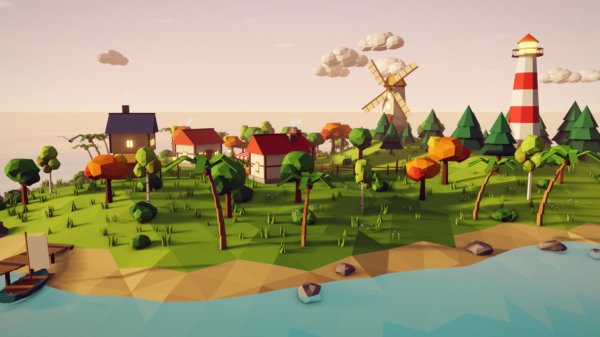
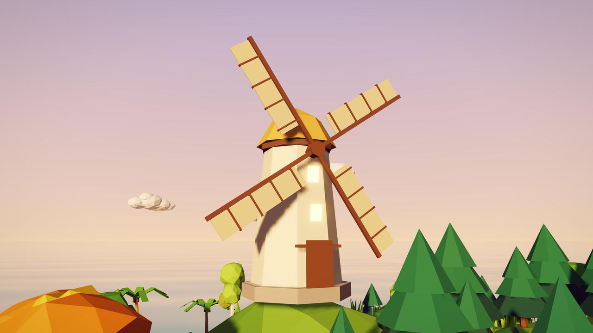
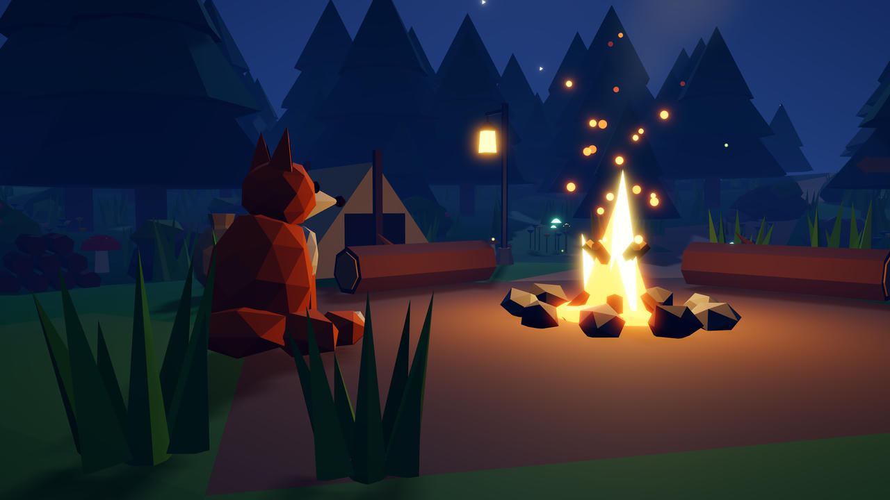
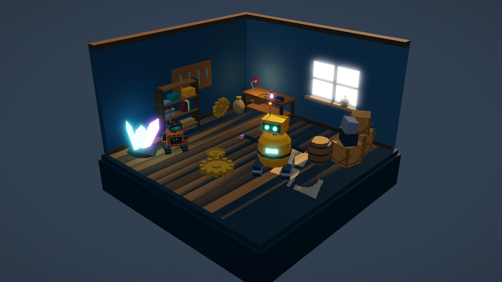
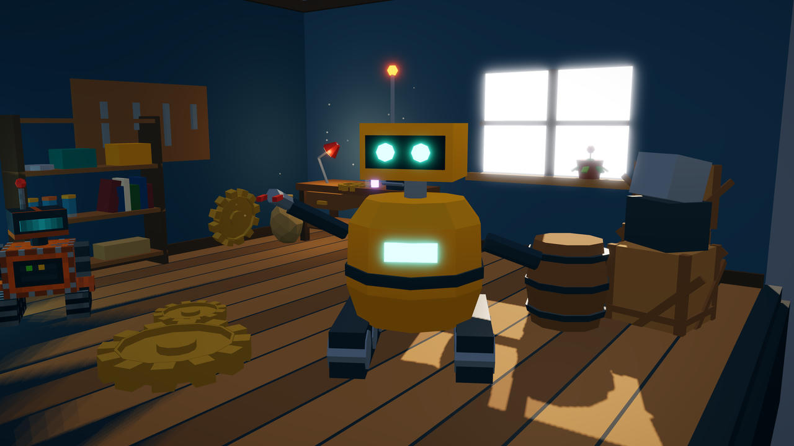
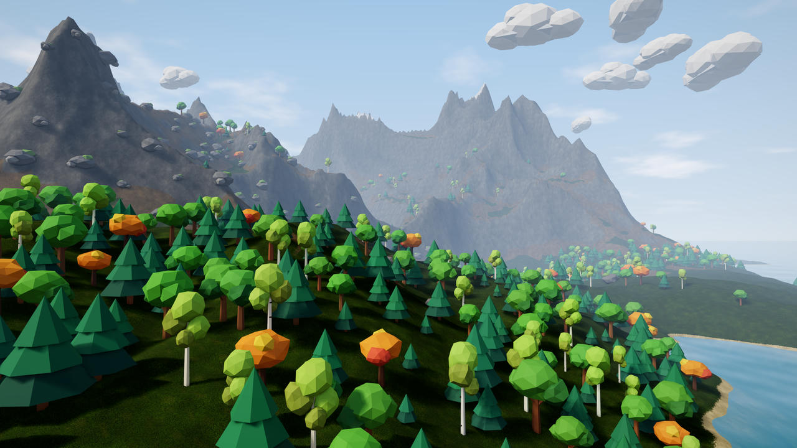
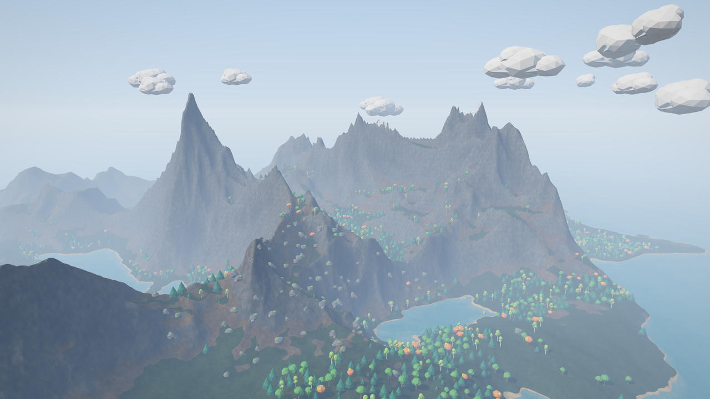

<p align="center"></p>

# Piska Engine

<p align="center"></p>

Игровой движок в стиле Unity на Rust. Игры строятся из `GameObject` и `Component` (не ECS).
Компоненты пишутся на Rust или на C++; сценарии (катсцены, обучение, события уровня) — на
своём маленьком языке **Scenario** с синтаксисом Lua и JavaScript, с горячей перезагрузкой.
В составе: редактор, 2D- и 3D-рендер на wgpu, физика Rapier, игровой интерфейс, звук с синтезатором.
Игры экспортируются в Windows, Linux, Android и браузер (WebAssembly).
Значок движка и игр — `assets/branding/` (рисует `tools/gen_icon.py`); как задать свой значок игре — `docs/api/export.md`, §12.

## Галерея

Снимки сцен-витрин (`cargo run --example showcase`): всё на картинках — низкополигональный
набор моделей, построенный кодом (`crates/engine/examples/showcase`), и обычные сцены
`assets/scenes/showcase/*.scene`, которые открываются в редакторе. Полные кадры
1920×1080 / 2560×1440 / 3840×2160 — в `docs/renders/`, подробности — `docs/api/showcase.md`.

| | |
|---|---|
|  |  |
|  |  |
|  |  |

## Возможности

### Ядро

- `GameObject` / `Component`, иерархия, жизненный цикл, сообщения и события.
- Reflection, сцены и префабы в формате RON, сохранение в файлы.
- Главный цикл с фиксированным шагом и сглаживанием поз между шагами.
- Ввод: клавиатура, мышь, касания, геймпад, карты действий с переназначением. В браузере геймпад идёт через Gamepad API (собран, на настоящем геймпаде не проверялся).
- Геймплей-API: таймеры, твины, смена сцен, сохранения, случайные числа, конечный автомат.
- Сценарии на языке Scenario (`.scenario`, синтаксис Lua + JavaScript): сопрограммы с `wait`, сообщения, API объектов, интерфейса и звука, горячая перезагрузка в Play без пересборки, ошибки с `file:line:col` (см. `docs/api/scenario.md`).

### Рендер

- 2D: спрайты с батчингом, слои сортировки, листы спрайтов, анимация, частицы, тайлмапы.
- 3D: меши с PBR-материалами, солнце с тенями, точечный свет, небо, туман, MSAA, HDR с блумом и ACES.
- Материалы-ассеты `.material` (PBR: карты нормалей, metallic-roughness, свечения, AO; вырез, полупрозрачность, двусторонние), по материалу на часть модели, редактор материалов с превью (см. `docs/api/materials.md`).
- Инстансинг мешей, батчинг спрайтов через текстуры, отсечение невидимого (см. `docs/api/performance.md`).
- Рельеф как в проекте-образце: процедурный (шум с сидом, море, горы, площадки) или по карте высот, чанки с LOD и подгрузкой вокруг камеры, слои по высоте и уклону, скульпт и раскраска кистью в редакторе, вода, коллайдер для 3D-физики (см. `docs/api/terrain.md`).
- Бэкенды через wgpu: Vulkan, DX12, Metal; в браузере WebGPU, запасной путь WebGL2.

### Физика

- 2D: Rapier2D, `Rigidbody2D` / `Collider2D`, триггеры, слои, raycast, односторонние платформы.
- 3D: Rapier3D, суставы, лучи, взрывной импульс, контроллер персонажа.

### Интерфейс

- Холст с якорями, текст (кириллица), картинки и 9-slice, кнопки, переключатели, ползунки, полосы прогресса, поля ввода, группы раскладки.
- Управление мышью, клавиатурой, геймпадом и касанием. Интерфейс собирается из объектов сцены и правится в инспекторе.

### Звук

- Клипы `.wav` и `.ogg`, источники и слушатель на объектах, микшер, шины громкости.
- Синтезатор: эффекты и музыкальные петли без единого файла.

### Логика на C++

- Компоненты на C++ с теми же хуками, что у Rust-компонентов; поля видны в инспекторе.
- Динамические плагины с горячей перезагрузкой; статическая линковка C++-кода в крейт игры.
- Граница Rust и C++ через C ABI, заголовок генерирует `cbindgen`.

### Ассеты

- `.meta`-файлы с постоянным GUID, типизированные ссылки `AssetHandle<T>`.
- Импорт мешей `.obj`, `.gltf`, `.glb` и моделей Piska Modeler `.pmodel` (меш со своей пиксельной текстурой).
- Упаковка всех ассетов в один файл (пак) для браузера и Android.

### Редактор

- Hierarchy, Inspector (строится из reflection), Scene в 2D и 3D с гизмо, вкладка Game.
- Редактор кода со сборкой, Project, Console, Profiler, Play / Pause / Step, Undo.
- Запуск своей игры в редакторе: `engine::edit` (см. `docs/api/editor.md`).
- Piska Modeler — редактор низкополигональных моделей из кубоидов с рисованием текстуры прямо по модели, группами-суставами, отражёнными близнецами, экспортом в `.glb` / `.obj`; отдельный репозиторий в `modeler/`: `cargo run --manifest-path modeler/Cargo.toml -p piska-modeler` (см. `docs/api/modeler.md`).

## Быстрый старт

### Установка зависимостей одной командой

Проще всего — **графический установщик** `piska-installer` (одна программа с окном для
Windows, Linux и macOS: выбор компонентов, точный план, ход установки, итоговая проверка;
`cargo run -p piska-installer`, готовые файлы — артефакты CI workflow `install`), см.
[«Графический установщик»](docs/install.md#графический-установщик). Без окна — скрипты:

Установщики ставят и настраивают Rust, компилятор C++, CMake, Android SDK / NDK, zig и пути в
настройках редактора по компонентам; есть режим `-DryRun` (ничего не меняет) и диагностика
`cargo run -p piska-export -- doctor`. Windows: `install\Install-PiskaEngine.cmd`; Linux / macOS:
`bash install/install.sh`. Подробности, таблица компонентов и ручная установка — в
[`docs/install.md`](docs/install.md).

### Требования

- Rust stable. Проверки проводились на Rust 1.97.
- GPU с драйвером Vulkan, DX12 или Metal. Без GPU окно не откроется.
- C++-компилятор для C++-моста: MSVC на Windows, GCC или Clang на Linux и macOS.
- CMake, если собирается C++-плагин `plugins/cpp-gameplay` (см. заголовок `crates/engine/examples/demo3d.rs`).
- Первая сборка занимает несколько минут.

### Piska Hub: проекты

```bash
cargo run -p piska-hub
```

Стартовое окно: список проектов, New Project из шаблона, Open — сборка и запуск редактора
проекта с ходом сборки (см. `docs/api/hub.md`).

### Редактор: демо

```bash
cargo run --example demo3d -- --editor
```

### Пример

```bash
cargo run --example hello_sprite
```

### Игра

```bash
cargo run -p template
```

## Игры-примеры

| Папка | Название | Жанр | Платформы | Описание |
|---|---|---|---|---|
| `games/lantern` | Хранитель фонаря | 2D-платформер | Web, Windows, Linux, Android | Дух-фонарь собирает светлячков в шести пещерах, открывает выходы, побеждает босса. |
| `games/swarm` | Рой | Аркадный шутер на выживание | Web, Windows, Linux, Android | Дрон защищает реактор в арене от волн врагов; улучшения, боссы на 5, 10, 15 и 20 волнах. |
| `games/marble` | Шаровой завод | 3D-аркада с физикой | Windows, Linux, Android | Катите стальной шар по цехам заброшенного завода; механизмы написаны на C++. В браузер не собирается. |
| `games/template` | Звездопад | Учебный пример (2D) | Web, Windows, Linux, Android | Спрайты, физика 2D, префаб, сцена из файла, интерфейс, звук, сохранение рекорда. От него начинается новая игра. |

Управление и правила каждой игры описаны в её `README.md`: `games/lantern/README.md`, `games/swarm/README.md`, `games/marble/README.md`.

## Структура проекта

| Путь | Что внутри |
|---|---|
| `crates/engine-core` | Ядро: GameObject/Component, сцена, reflection, сериализация, главный цикл. Без окна и GPU. |
| `crates/engine-assets` | База ассетов: `.meta`-файлы, GUID, типизированные ссылки `AssetHandle<T>`. |
| `crates/engine-render` | Рендер на wgpu: спрайты, меши, тени, небо, пост-обработка, частицы, тайлмапы, окно на winit, захват кадра. |
| `crates/engine-physics` | Физика: 2D на Rapier2D, 3D на Rapier3D (подробности в `DESIGN.md`). |
| `crates/engine-audio` | Звук: клипы, синтезатор, микшер, источники, слушатель, шины громкости. |
| `crates/engine-ui` | Игровой интерфейс: холст, текст, кнопки, ползунки, поля ввода, раскладка. |
| `modeler/` | Piska Modeler — отдельный репозиторий (подмодуль), своё рабочее пространство Cargo: `crates/engine-modeler` (библиотека) и `crates/piska-modeler` (программа). |
| `modeler/crates/engine-modeler` | Piska Modeler: документ модели, операции и Undo, развёртка, рисование, формат `.pmodel`, экспорт `.glb` / `.obj`, интерфейс на egui (фича `ui`). |
| `modeler/crates/piska-modeler` | Отдельное окно Piska Modeler, снимки и замер без окна. |
| `crates/engine-cpp-bridge` | Граница Rust и C++: статические C++-модули и динамические плагины через C ABI. |
| `crates/engine-cpp-build` | Помощник `build.rs`: собирает C++-код игры и линкует его в крейт игры. |
| `crates/engine-editor` | Редактор на egui и wgpu. |
| `crates/engine` | Фасад: `use engine::prelude::*;`, `engine::app()`, `engine::edit`. Примеры и тесты. |
| `games/` | Игры-примеры и шаблон `template`. |
| `tools/piska-export` | Экспорт игр для браузера, Windows, Linux и Android; локальный сервер для проверки. |
| `tools/piska-hub` | Piska Hub — стартовое окно: проекты, новый проект из шаблона, открытие в редакторе с ходом сборки, примеры и документация (`cargo run -p piska-hub`). |
| `plugins/` | C++-плагины: `cpp-gameplay` (компоненты для `demo3d`) и `cpp-example` (пост-эффект). |
| `docs/` | Документация API в `docs/api/` и скриншоты. |

## Экспорт

Игра — это крейт в `games/<имя>/`. Команды запускаются из корня рабочего пространства,
`<игра>` — имя каталога в `games/`.

| Платформа | Команда | Что получается | Требования и проверка |
|---|---|---|---|
| Браузер | `piska-export web --game <игра> --release` | `dist/<игра>/web/`: `index.html`, `game.js`, `game_bg.wasm`, `assets.pak` | `rustup target add wasm32-unknown-unknown`. WebGPU работает по HTTPS или на `localhost`, иначе используется WebGL2. Работает. |
| Windows | `piska-export windows --game <игра> --release` | `dist/<игра>/windows/`: `<игра>.exe` и каталог `assets/`. Раздаётся каталог целиком. | Собирается только на Windows, тулчейн `x86_64-pc-windows-msvc`. Работает. |
| Linux | `piska-export linux --game <игра> --release --tar` | `dist/<игра>/linux/`: программа (ELF x86_64), `assets/`, значок, `.desktop`; с `--tar` ещё `.tar.gz`. | На Linux это обычная сборка, пакеты для сборки перечислены в `docs/api/export.md` §10.1. С Windows — через zig (`--zig <путь к zig.exe>`). Собрано и проверено статически, **на Linux не запускалось** (§10.6). |
| Android | `piska-export android --game <игра> --release` | `dist/<игра>/android/<игра>.apk`: подписанный APK, ставится через `adb install`. Gradle не нужен. | Android SDK (build-tools, платформа), NDK r23+, Java 11+, `cargo-ndk`, цель `aarch64-linux-android`. APK собран и проверен статически, **на устройстве не запускался** (§9.7). |

Сервер для проверки браузерной сборки (слушает только `127.0.0.1`):

```bash
cargo run -p piska-export -- serve dist/template/web --open
```

Пример сборки для браузера:

```bash
cargo run -p piska-export -- web --game template --release
```

Подробности, ограничения и команды CI: `docs/api/export.md`. Сборки всех четырёх платформ
для `template` описаны в `.github/workflows/build.yml`.

## Документация

| Файл | Что внутри |
|---|---|
| [DESIGN.md](DESIGN.md) | Архитектура движка, план работ и подробные разделы по каждой подсистеме (на русском). |
| [docs/api/hub.md](docs/api/hub.md) | Piska Hub: список проектов, новый проект, открытие в редакторе, Samples, файлы `hub.ron` / `recent.txt`, API для тестов. |
| [docs/api/gameplay.md](docs/api/gameplay.md) | Геймплей-API: время, таймеры, твины, смена сцен, запросы к сцене, сохранения, ввод. |
| [docs/api/ui.md](docs/api/ui.md) | Игровой интерфейс: холст, текст, кнопки, раскладка, главное меню. |
| [docs/api/audio.md](docs/api/audio.md) | Звук: клипы, синтезатор, источники, слушатель, шины громкости. |
| [docs/api/2d.md](docs/api/2d.md) | 2D: листы спрайтов, анимация, частицы, тайлмапы, порядок отрисовки. |
| [docs/api/materials.md](docs/api/materials.md) | Материалы: ассеты `.material`, карты нормалей / metallic-roughness / свечения / AO, вырез и прозрачность, двусторонние, материалы по частям модели, редактор материалов, цена и пакетная отрисовка. |
| [docs/api/terrain.md](docs/api/terrain.md) | Рельеф и вода: параметры шума, карта высот, чанки и LOD, слои текстур, коллайдер, запросы высоты, кисти скульпта и раскраски, хранение правок. |
| [docs/api/cpp.md](docs/api/cpp.md) | Логика игры на C++: компоненты, плагины, горячая перезагрузка, статическая линковка. |
| [docs/api/scenario.md](docs/api/scenario.md) | Сценарии на языке Scenario: учебник, справочник языка (формы Lua и JS), API движка, Rust-хост, пределы, ошибки, горячая перезагрузка. |
| [docs/api/modeler.md](docs/api/modeler.md) | Piska Modeler: окно, инструменты и горячие клавиши, развёртка и рисование, формат `.pmodel`, `.pmodel` в движке, экспорт, API библиотеки. |
| [docs/api/editor.md](docs/api/editor.md) | Редактор и запуск своей игры в нём через `engine::edit`. |
| [docs/api/script-order.md](docs/api/script-order.md) | Порядок выполнения скриптов (`execution_order`, `project.settings`, окно Project Settings) и сортировка, фильтры, группы в окнах Project и Add Component. |
| [docs/api/performance.md](docs/api/performance.md) | Как мерить производительность и что движок делает сам; пример `stress`. |
| [docs/api/export.md](docs/api/export.md) | Крейт игры, экспорт в браузер, Windows, Linux и Android, сборка в CI. |

## Написать свою игру

1. Скопируйте `games/template` в `games/my_game` и поменяйте имя пакета в `games/my_game/Cargo.toml`.
   Новый каталог в `games/` подхватывается рабочим пространством сам.
2. Задайте заголовок игры в `[package.metadata.piska]` (см. `docs/api/export.md` §1.2).
3. Напишите компонент в `src/lib.rs` (пример ниже) и зарегистрируйте его в `register(app)`.
4. Положите сцены, префабы и спрайты в `assets/`. Файлы `.meta` храните в системе контроля версий.
5. Проверьте запуск: `cargo run -p my_game`. Каталог `games/my_game` должен совпадать с `--game my_game`.
6. Запустите тесты без окна: `cargo test -p my_game`.
7. Проверьте, что игра собирается для браузера: `cargo check -p my_game --target wasm32-unknown-unknown`.
   Экспорт описан в `docs/api/export.md` §1 и §2.

Минимальный компонент (по образцу `docs/api/export.md` §1.3):

```rust
use engine::prelude::*;

component! {
    /// Игрок.
    pub struct Player { pub speed: f32 = 6.0 }
}

impl Component for Player {
    fn on_update(&mut self, ctx: &mut Ctx, dt: f32) {
        let run = ctx.input().axis("Horizontal");
        ctx.transform().position.x += run * self.speed * dt;
    }
}
```

## Тесты

```bash
cargo test --workspace
```

Для запуска без звуковой карты (CI, сервер) задайте `ENGINE_AUDIO=off`: звуковое устройство
тогда не открывается (`docs/api/audio.md`).

```bash
ENGINE_AUDIO=off cargo test --workspace
```

Тесты рендера на Linux в CI выполняются через Mesa lavapipe, то есть без видеокарты.

## Лицензия

MIT или Apache-2.0 на выбор (`LICENSE-MIT`, `LICENSE-APACHE`) — при распространении самого движка, его исходников и программ нужно сохранять указание авторства.

Использование движка как инструмента указания авторства **не требует**: игры и всё остальное, что вы сделали с его помощью (включая сборки игр с вкомпилированным движком), можно распространять без упоминаний и без копии лицензии — см. [LICENSE-EXCEPTION.md](LICENSE-EXCEPTION.md).
