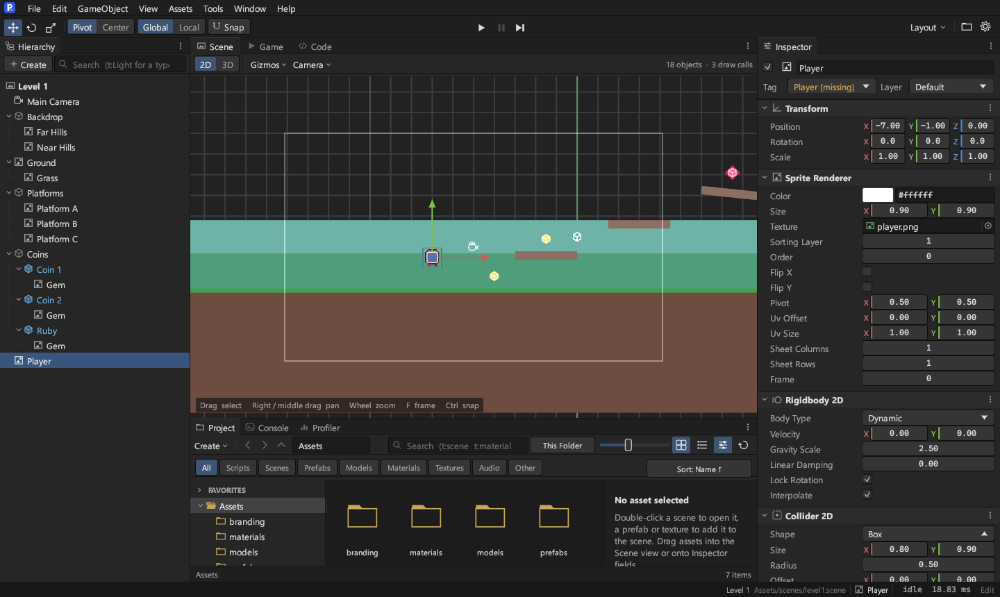

# Редактор Piska Engine

Редактор — библиотека `engine::editor` (крейт `engine-editor`, фича `editor` крейта
`engine`). Игра запускает его сама, со своими компонентами: всё, что объявлено через
`component!` и зарегистрировано в `App`, сразу видно в инспекторе, в окне Add Component
и сохраняется в сцену.



## Запуск

```rust
use engine::prelude::*;

fn main() -> Result<(), EngineError> {
    let mut app = engine::app();               // рендер, физика, звук, UI, эффекты
    app.register::<PlayerController>();        // свои компоненты
    engine::mount_assets(&mut app, "assets")?; // каталог ассетов (окно Project)

    if std::env::args().any(|a| a == "--editor") {
        return engine::edit(
            app,
            EditorConfig::titled("My Game")
                .open_scene("scenes/level1.scene")          // путь внутри assets
                .code_dir("src")                            // исходники во вкладке Code
                .cpp_scripts("plugins/game/scripts")        // куда класть новые C++-скрипты
                .build_command(
                    BuildCommand::new("C++ plugin", "cmake").args(["--build", "build"]),
                )
                .with_size(1600, 900),
        );
    }
    engine::run(app, WindowConfig::default())
}
```

`EditorConfig`:

| метод | что делает |
|---|---|
| `titled(title)` / `default()` | заголовок окна |
| `open_scene("scenes/x.scene")` | открыть сцену при старте (путь относительно каталога ассетов) |
| `with_size(w, h)` | размер окна в логических пикселях |
| `code_dir(dir)` | показать каталог исходников (Rust, C++, WGSL…) во вкладке Code и в окне Project |
| `cpp_scripts(dir)` | каталог C++-плагина для команды «New C++ Script» |
| `rust_scripts(dir)` | каталог скриптов на Rust для «New Rust Script» (см. «Скрипты на Rust») |
| `relaunch(Relaunch)` | Build пересобирает программу cargo и перезапускает редактор с новым кодом |
| `build_command(BuildCommand)` | что запускает Build (Ctrl+B), по порядку; вывод — в Console |
| `ui_scale(1.25)` | масштаб интерфейса; без него берётся сохранённый в Preferences |

`BuildCommand::new(label, program).args([...]).dir(path).restart_required()` — команда
сборки; `restart_required()` помечает код на Rust, который заработает после перезапуска.

Переменные окружения для автоматических прогонов (их понимает `engine::edit`):
`ENGINE_FRAMES=N` — закрыться после N кадров; `ENGINE_SCREENSHOT=out.png` — нарисовать
редактор в файл без окна; `ENGINE_PLAY=1` — сразу Play; `ENGINE_VSYNC=0/1` — переопределить
вертикальную синхронизацию (для замеров).

## Окна

* **Hierarchy** (слева) — дерево объектов. Строки рисуются только в видимой части окна
  (5 000 объектов прокручиваются так же быстро, как 50), у уровней — направляющие, фон строк
  чуть чередуется (выключается в меню окна), у свёрнутого родителя справа — число детей,
  длинное имя обрезается «…» (полное — в подсказке). Над деревом — строка сцены: имя
  открытой сцены — выпадающий список всех сцен проекта (стартовая первой, `*` — правки не
  сохранены), выбор в два щелчка. **Поиск**: буквы ищутся по порядку (`rl3` находит
  `Rail L 3`), `t:Camera` — по типу компонента, `tag:Player` — по тегу, `layer:UI` — по слою;
  совпадения подсвечены, над деревом — их число; по умолчанию совпадения показаны в дереве
  с предками (соседи скрыты), «Show as List» — плоский список с путём родителей. Меню окна
  «⋮»: Expand All / Collapse All, Reveal Selection, порядок Scene Order / Alphabetical (только
  показ, сцена не меняется), вид результатов поиска, чередование строк, Unlock All.
  Клавиши (окно в фокусе): ↑ / ↓ — соседняя строка (Shift — расширить выделение), → —
  раскрыть, ещё раз — к первому ребёнку, ← — свернуть, ещё раз — к родителю; буквы — переход
  к строке, имя которой так начинается (первая буква, занятая сочетанием — W, E, R, F, H, Z, —
  остаётся сочетанием; дальше, пока набор идёт, все буквы — в набор). Alt+щелчок по стрелке
  раскрывает или сворачивает всё поддерево. Выделение из вида Scene раскрывает предков и
  прокручивает список к строке. Переименование на месте (двойной щелчок или F2),
  перетаскивание: на строку — сделать дочерним (над свёрнутым родителем через полсекунды
  он раскрывается), к верхнему или нижнему краю строки — поставить перед / после неё
  (линия-указатель), на строку сцены или пустое место — в корень; у края списка он
  прокручивается сам. Справа в строке — **замок** (объект с детьми нельзя выбрать щелчком и
  рамкой в виде Scene; только в редакторе, в сцену не пишется) и **глаз** (включить /
  выключить объект): видны при наведении и остаются, когда включены. Сцену из окна Project
  можно бросить на пустое место иерархии — она откроется (с вопросом о несохранённом),
  префаб — создастся; остальное не принимается (подсказка у курсора). Правая кнопка — меню:
  создать дочерний объект, переименовать, дублировать, удалить, переставить, Lock in Scene
  View, Expand / Collapse All Children, сохранить как префаб / распаковать префаб. Строку
  можно бросить в окно Project — объект сохранится префабом в открытый каталог.
* **Inspector** (справа) — карточки компонентов, поля строятся по reflection. У карточки
  меню «⋮»: Reset (значения по умолчанию), Copy / Paste Values, Remove Component.
  Векторы — с цветными X/Y/Z, цвет — образец с палитрой и шестнадцатеричным кодом,
  перечисления — выпадающим списком, ассеты — кнопкой со списком и поиском (туда же
  можно перетащить ассет из окна Project), списки — по элементу с кнопками Add / ✕.
  **Add Component** — поиск и категории (Rendering, 2D, Physics, Audio, UI, Effects,
  Animation, Camera, Scripts); Enter добавляет первое совпадение. Подсказка поля —
  doc-комментарий поля в `component!`.
* **Scene / Game / Code** (центр). Scene — камера редактора и гизмо; Game — камера сцены,
  как в собранной игре (полоса сверху: размер «экрана», Maximize On Play); Code — редактор
  исходников. Scene и Game — отдельные окна: их можно поставить рядом.
* **Project / Console / Profiler** (снизу).

Расположение окон — раскладка по умолчанию; любое окно можно перетащить, см. «Окна и
раскладки».

## Панель инструментов

Слева направо — по задачам: инструменты Move / Rotate / Scale (W / E / R) → их параметры
подписанными переключателями: **Pivot | Center** (Z — вокруг активного объекта или середины
выделения), **Global | Local** (оси мира или объекта), **Snap** (0.5 м, 15°, ×0.1; Ctrl
временно инвертирует). По центру — Play / Pause / Step: в режиме Play кнопка становится
акцентной, панель тонируется акцентом и снизу у неё полоса акцента (как в Unity), вид Game
получает рамку. Справа — **Layout ▾** (раскладки окон), кнопка Project Hub и шестерёнка
Preferences. Параметры вида (2D / 3D, сетка, значки, туман) — на полосе вида Scene.

**Строка состояния**: слева — последнее сообщение консоли со значком уровня (щелчок
открывает Console); справа — идущая сборка с полосой прогресса, сцена (`*` — есть
несохранённые правки) и её файл, выделенный объект, частота кадров редактора (щелчок —
Profiler), режим (Edit / Playing / Paused), а в Play — у кого ввод: «Game input» или
«Editor input».

**Ввод в режиме Play.** Как в Unity, клавиатура, мышь, касания и геймпады идут игре только
пока фокус у окна Game: Play сам даёт ему фокус (Preferences → Game View → Input → **Focus
Game view on Play**, по умолчанию включено), щелчок по виду Game возвращает его. Щелчок по
другому окну (Scene, Inspector, Hierarchy, Code…), **Shift+Esc** (Esc без Shift остаётся
игре), потеря фокуса окном редактора, Pause и Stop отдают ввод редактору: всё нажатое
отпускается, стики геймпадов — в нуле (`Input::set_gamepads_suspended`), в виде Scene
работают полёт и буквы инструментов. Вид Game с вводом — в рамке акцента; без ввода —
тонкая серая рамка и подсказка «щёлкните, чтобы играть». Щелчки по меню и окнам поверх
вида Game игре не достаются. `Editor::game_has_input_focus()` — для тестов.

**Захват курсора** (игры от первого лица, `Input::set_cursor_captured(true)` — просьба игры,
см. `fps.md`): редактор даёт его, только пока идёт Play, ввод у игры и поверх вида Game нет
меню, всплывающего окна или диалога. Тогда курсор системы запирается (на Windows — держится
в окне и возвращается в середину вида Game) и прячется, а игра получает сырое движение мыши
(`DeviceEvent::MouseMotion`). Внизу вида Game подсказка «Shift+Esc — release the mouse».
Shift+Esc, щелчок по другому окну, потеря фокуса окном, Pause, открытое меню отпускают
курсор, но просьба игры остаётся: щелчок по виду Game захватывает его снова. Stop и смена
сцены снимают и захват, и просьбу. Для тестов: `Editor::game_cursor_captured()`,
`Editor::add_raw_mouse_motion(dx, dy)`.

**Edit → Undo History** — шаги Undo сцены по именам действий («Rename», «Create Empty»;
правки мышью и в инспекторе — «Edit»), текущая позиция выделена, шаги, которые вернёт Redo,
приглушены; щелчок по строке — перейти к ней (Undo / Redo нужное число раз).

**Инспектор**: правая кнопка по подписи поля — Copy, Paste (значение того же вида), Reset to
Default. Длинные компоненты разбиты подзаголовками (у `FpsController` — Movement, Body, Speed
Modifiers, Jumping and Noclip, Input, Look, Camera, State During Play); у объекта с
`FpsController` в иерархии — значок перекрестия.

**Console**: у каждой записи время прихода в окно — от запуска редактора (`мм:сс.с`; лог
движка времени не хранит, часового пояса без сторонних крейтов не узнать).

**Code**: Ctrl+F — поиск, Ctrl+H — поиск с заменой (Replace, Replace All), Ctrl+G — перейти
к строке.

Если в сцене есть скрипты, которых нет в этой программе редактора (проект с кодом на Rust
открыт в общем Piska Editor, пока программа проекта не собрана), над видом Game —
плашка: каких скриптов нет и почему игра без них «не работает», кнопка **Build Scripts**
(собрать программу проекта; редактор перезапустится в неё с той же сценой) или ход идущей
сборки; в Console при Play — предупреждение.

Вид Scene: над видом — полоса **2D | 3D** (клавиша 2), **Gizmos ▾** (значки и коллайдеры,
сетка, **Fog** — туман сцены; по умолчанию в виде Scene выключен, как в Unity, выбор
хранится в Preferences → Scene View; вид Game туман показывает всегда), **Camera ▾**
(3D View, Frame Selected, Frame Whole Scene, скорость полёта) и сводка «объекты · draw
calls». Подсказка мыши в углу вида — пары «клавиша — действие» через « · ».

Мышь и клавиши в виде Scene:

| действие | 3D | 2D |
|---|---|---|
| выбрать | щелчок; Ctrl+щелчок — добавить / убрать; Shift+щелчок — добавить | так же |
| рамка выделения | левая кнопка по пустому месту (Ctrl / Shift — как у щелчка) | так же |
| обзор и полёт | зажать правую кнопку: мышь — взгляд, W / A / S / D — вперёд / влево / назад / вправо, Q / E — вниз / вверх, Shift — втрое быстрее, колесо — скорость полёта (на экране на секунду) | правая кнопка + W / A / S / D — сдвиг |
| вращение вокруг точки | Alt + левая кнопка; или потянуть значок ориентации | — |
| сдвиг | средняя кнопка или Space + левая | правая / средняя кнопка, Space или Alt + левая |
| ближе / дальше | колесо; Alt + правая кнопка | колесо |
| стрелки | вид в фокусе: вперёд / назад, вбок | сдвиг |
| показать выделенное | F (всё выделение); двойной щелчок по строке Hierarchy | так же |

Пока правая кнопка зажата, буквы инструментов (W / E / R) не срабатывают — это полёт.
Скорость полёта, скорость взгляда, туман — Preferences → Scene View.

Гизмо действует на всё выделение: перемещение сдвигает все объекты (привязка — по
активному), поворот и масштаб — вокруг активного объекта (Pivot) или середины выделения
(Center); Alt + перетаскивание стрелки перемещения сначала дублирует выделение. Одно
перетаскивание — один шаг Undo.

**Рельеф.** Выделите объект с `Terrain` в 3D-виде — внизу слева появится панель Terrain:
Off, Raise, Lower, Smooth, Flatten, Paint, ползунки Size / Strength / Falloff, высота для
Flatten (Ctrl+щелчок берёт её из-под курсора) и слой для Paint. Под курсором на земле —
круг кисти; мазок левой кнопкой — один шаг Undo. Пока кисть выбрана, левая кнопка не
двигает камеру и не выделяет объекты. Инспектор `Terrain`: черновик параметров формы и
Regenerate (спросит, сохранить ли скульпт), слои текстур, Clear для скульпта. Из кода и
тестов: `set_terrain_tool`, `set_terrain_brush`, `terrain_brush_point`, `create_terrain`.
Подробно — `docs/api/terrain.md`. Ассет из окна Project можно бросить в вид:
префаб создаёт экземпляр, текстура — спрайт, сцена открывается.

## Меню

* **File** — **New Scene…** (Ctrl+N: 2D — камера; 3D — камера с перспективой,
  направленный свет и земля, вид Scene переключается в 3D), **Open Scene…** (Ctrl+O: окно со
  всеми `.scene` проекта — имя, каталог, когда изменена, стартовая сцена первой; поиск
  буквами по порядку, ↑ / ↓, Enter открывает, Esc закрывает), **Open Recent Scene ▸**
  (10 последних сцен этого проекта, хранятся в настройках редактора), Save, Save As…
  (Ctrl+Shift+S), Preferences…, Quit. Сцена с несохранёнными правками перед заменой
  спрашивает Save / Don't Save / Cancel; идущая игра останавливается. **Project Hub…** — вернуться в Piska Hub (сначала вопрос про
  несохранённую сцену; редактор закрывается), **Open Recent ▸** — недавние проекты хаба,
  выбранный открывает хаб (`hub.md`, §7).
* **Edit** — Undo / Redo, Duplicate, Rename, Delete, Frame Selected, Select None,
  Play / Pause / Step, Project Settings… (настройки проекта, см. ниже).
* **Tools** — **Model Editor (Piska Modeler)** (если программы `piska-modeler` нет рядом
  с редактором, в `CARGO_TARGET_DIR` и не задан `PISKA_MODELER` — окно с объяснением, как её
  собрать: `cargo build --manifest-path modeler/Cargo.toml -p piska-modeler`), New
  Model…, **New Scenario Script…**, Scenario Documentation (открывает `docs/api/scenario.md`
  во вкладке Code), New Rust Script…, New C++ Script….
* **Help** — **Getting Started** (карточки «как сделать…»: скрипт на Rust / C++ /
  Scenario, модель, рельеф, материал, сборка игры — у каждой кнопка первого шага),
  **Keyboard Shortcuts** (F1; шпаргалка из реестра команд с текущими клавишами), Editor
  Manual.
* **GameObject** — Create Empty, Create Empty Child, 3D Object ▸ (Cube, Sphere, Cylinder,
  Plane), 2D ▸ (Sprite, Tilemap, Animated Sprite, Sprite with Physics), Light ▸,
  Audio ▸, UI ▸ (Canvas, Text, Image, Button, Toggle, Slider, Progress Bar, Input Field),
  Effects ▸ (Particle System, Trail), Physics ▸, Camera. Пункт появляется, только если
  его компоненты зарегистрированы (`engine::app()` регистрирует все). Элементы UI
  создаются под холстом: под выделенным `Canvas`, под любым в сцене, иначе создаётся новый.
  В 3D Object ▸ ещё Terrain (рельеф 512 м с центром в начале координат) и Water; пункт
  **Snap to Terrain** ставит выделенный объект на рельеф под ним.
* **View** — 3D-вид, сетка, гизмо, привязка, UI Scale ▸.
* **Window** — окна (Ctrl+1…8), Layouts ▸ (Default, 2 by 3, Tall, Wide, свои раскладки,
  Save Layout…, Delete Layout ▸, Reset Layout); см. «Окна и раскладки».
* **Assets** — Refresh, New Folder…, Import New Asset…, Reveal in File Manager, New Rust Script…, New C++ Script…,
  New Scenario Script… (сценарий на языке Scenario в `assets/scenarios/`, без сборки и с горячей
  перезагрузкой — см. `scenario.md`), Build Code.

Недоступный пункт показан серым, подсказка объясняет почему.

## Project

Окно Project — файловый менеджер ассетов, как в Unity: слева дерево, в центре содержимое, справа
сведения. Пути всегда относительно проекта (`Assets/prefabs/coin.prefab`); все операции идут только
внутри каталога ассетов, `.meta` всегда едет вместе с файлом, поэтому GUID и ссылки из сцен,
префабов и материалов (они ссылаются на GUID) переживают перенос и переименование.

```
┌ ‹ › ˄ │ Assets › models › props │ [This Folder ▾] [поиск t:scene …] ▭ ≡ ◑ ⟳ ┐
│ чипы типов (All Scripts Scenes …)                              Sort: Name ↑ │
├────────────┬──────────────────────────────────────────────┬─────────────────┤
│ FAVORITES  │  плитки с миниатюрами  или  список со        │ сведения:       │
│  All Scenes│  столбцами Name / Type / Modified / Size     │ предпросмотр,   │
│  models    │                                              │ путь, GUID,     │
│ ▾ Assets   │                                              │ или сводка по   │
│   ▸ models │                                              │ выделенному     │
├────────────┴──────────────────────────────────────────────┴─────────────────┤
│ Assets/models/crystal.obj                                            12 items│
└──────────────────────────────────────────────────────────────────────────────┘
```

**Навигация.** Кнопки Назад / Вперёд / Вверх (история переходов; Alt+← / Alt+→ / Alt+↑,
кнопки мыши 4 и 5, Backspace — вверх). Строка пути — кликабельные крошки (`Assets › models`);
на крошку можно бросить элементы; щелчок по пустому месту строки превращает её в поле, где
путь можно набрать (`Assets/models`, Enter; неверный путь подсказывает ошибку и остаётся в
поле). Двойной щелчок по каталогу — войти. В узком окне (< 460 px) дерево сворачивается в
кнопку-список рядом с крошками, а сведения уезжают вниз (< 640 px).

**Выделение.** Щелчок; Ctrl — добавить или убрать; Shift — диапазон от якоря; резинка в пустом
месте (с Ctrl добавляет к выделению); Ctrl+A. Несколько элементов — справа сводка (сколько
файлов и каталогов, общий размер, по типам). Один ассет — предпросмотр и параметры импорта, как
раньше.

**Операции над выделением.**

| что | как |
|---|---|
| вырезать / копировать / вставить | Ctrl+X / Ctrl+C / Ctrl+V; вставка в открытый каталог; занятое имя получает `name (1)` |
| дублировать | Ctrl+D: копия рядом с оригиналом (`a (1).png`) с новым GUID |
| переместить | перетащить на каталог в дереве, плитку каталога, крошку; несколько элементов сразу; Ctrl при отпускании — копия |
| переименовать | F2 или медленный второй щелчок: поле прямо на месте, расширение не выделено; Esc — отмена, под полем текст ошибки (пустое имя, недопустимые символы, зарезервированное имя Windows, занятое имя) |
| удалить | Del: в **корзину ОС** (Windows — через системную корзину; macOS — Finder; Linux — `gio trash`). Если на системе корзины нет, окно спрашивает и прямо пишет, что удаление безвозвратное |
| создать | Create ▸ в меню правой кнопки: Folder (сразу вводится имя), Scene, Prefab from Selection, Material, Rust / C++ / Scenario Script, Model |

Копии получают новые GUID (база не принимает два ассета с одним GUID); перенос и переименование
сохраняют GUID. Операция над несколькими файлами пересканирует базу ассетов **один раз**; если
часть не удалась, всплывающее сообщение и консоль говорят точно, что сделано, а что нет
(`Moved 3 of 5 items. 'a.png': … The rest was done.`). Если вы стоите в каталоге, который удалили,
окно поднимается к существующему родителю.

**Импорт.** Файлы и каталоги из файлового менеджера ОС можно бросить на окно: они копируются
в открытый каталог (в фоне, с полосой прогресса; существующие файлы не перезаписываются —
новое имя `name (1)`; чужие `.meta` не берутся, база создаёт свои). Меню **Assets → Import New
Asset…** и пункт в меню правой кнопки открывают встроенный браузер файлов (выбор нескольких
файлов и каталогов Ctrl-щелчком, двойной щелчок — войти).

**Избранное и поиск.** Раздел **Favorites** сверху дерева: готовые поиски (All Scripts, All
Scenes, All Models, All Materials, All Prefabs) и закреплённые каталоги (перетащить каталог на
заголовок или Add to Favorites в меню). Поиск (Ctrl+F — в поле): слова ищутся в пути, токены
`t:scene`, `t:script`, `t:prefab`, `t:model`, `t:material`, `t:texture`, `t:audio`, `t:other`
фильтруют по типу (`coin t:scene`); область — **This Folder** (каталог и всё под ним) или **All
Assets**; звезда рядом с полем сохраняет запрос в Favorites (удалить — меню правой кнопки);
в строке состояния — число результатов. Избранное, сохранённые поиски, ширины столбцов, положение
разделителя, размер плитки и вид хранятся в настройках редактора.

**Вид.** Кнопки Tiles / List и бегунок размера (левый край бегунка — компактный список). В списке
границы столбцов Type / Modified / Size тянутся мышью, ширины запоминаются; столбцы убираются
сами, когда не хватает места имени. Разделитель между деревом и содержимым тянется и
запоминается. Кнопка справа сворачивает панель сведений. Длинные имена сжимаются посередине
(`очень_дли…имя.png`), полное имя — в подсказке. Рисуются только видимые элементы: папка из
5000 файлов не замедляет окно (кадр порядка миллисекунд, проверено тестом).

**Меню правой кнопки** (элемент, каталог, пустое место, строка дерева): Create ▸, Open /
Add to Scene / Create Sprite / Open Scene…, Open in Code Tab (Edit as Text для сцен и префабов),
Show in File Manager, Cut / Copy / Paste / Duplicate, Rename, Delete, Copy Path, Copy GUID,
Add to Favorites, Reimport, Find References In Scene (выделяет объект открытой сцены, который
использует ассет; в сообщении — сколько их), Properties (открывает панель сведений).

**Клавиши** (работают, пока курсор над окном Project; поле ввода забирает клавиши себе):

| клавиша | действие |
|---|---|
| ← → ↑ ↓, Home, End, PageUp, PageDown | перемещение по плиткам (в двух измерениях) и по списку; с Shift — растянуть выделение |
| буквы | прыжок к элементу с таким началом имени (пауза > 1 с начинает слово заново; одна буква повторно — следующий) |
| Enter | открыть (каталог — войти, сцена — открыть, префаб — в сцену, текстура — спрайт, код — во вкладку Code) |
| F2 | переименовать на месте |
| Delete | удалить в корзину |
| Ctrl+A / Ctrl+C / Ctrl+X / Ctrl+V / Ctrl+D | всё / копировать / вырезать / вставить / дублировать |
| Ctrl+F | в поле поиска |
| Ctrl+R | пересканировать ассеты |
| Backspace, Alt+↑ | вверх на уровень |
| Alt+← / Alt+→, кнопки мыши 4 / 5 | назад / вперёд |
| Esc | снять выделение (в поле — отмена) |

Пока курсор над окном Project, Delete, F2, Ctrl+D и одиночные буквы принадлежат ему, а не
Hierarchy и инструментам сцены.

### Сортировка, фильтры и группы

Под путём — полоса с **чипами типов** (All, Scripts, Scenes, Prefabs, Models, Materials, Textures,
Audio, Other; можно включить несколько) и кнопкой **Sort: …** (Name, Type, Date modified, Size, по
возрастанию и убыванию; каталоги всегда впереди, `Level2` раньше `Level10`). Фильтр и сортировка
работают в плитках, списке и результатах поиска. Список показывает столбцы Name, Type, Modified, Size:
щелчок по заголовку сортирует, стрелка показывает направление. «Code» показывает исходники по языкам
(Rust, C++, Scenario) со счётчиками. Выбор хранится в настройках редактора. Подробно —
`script-order.md`.

### Предпросмотр моделей

Меши (`.obj`, `.gltf`, `.glb`) в плитках и в списке показываются **отрисованными
миниатюрами**: модель вписана в кадр, освещена ключевым и заполняющим светом (свет
привязан к камере), вид в три четверти, тёмный градиентный фон, сглаживание включено.
Каждая часть модели рисуется своим материалом из файла (`.mtl` или glTF: цвет,
металл, шероховатость, свечение, карты, если текстуры лежат в каталоге ассетов).

Если модель выделена, справа — **большой вид**: тяните мышью — вращение, колесо —
приближение, двойной щелчок — вернуть вид; пока вы не коснулись, модель медленно
вращается. Под ним: вершины, треугольники, части (`Sub-meshes`), размеры (`Bounds`),
материалы с цветом и текстурой, размер файла.

Как это устроено и сколько стоит:

* Рисует тот же рендерер и то же устройство, что и сцену редактора, во временном мире
  (модель и два источника света): сцена пользователя не трогается, меши и текстуры берутся
  из общих кэшей рендерера — на GPU модель загружается один раз.
* Окно Project только *просит* картинку; рисуется не больше трёх миниатюр за кадр, пока
  картинки нет — иконка. Просят только плитки, попавшие в видимую часть окна: скрытое окно
  Project или модели за краем прокрутки ничего не стоят.
* Миниатюра лежит в кэше по GUID и не перерисовывается, пока файлы модели (`.obj`, `.mtl`,
  текстуры, буферы glTF) не изменились на диске; это проверяется при пересканировании
  ассетов (Ctrl+R, возвращение фокуса в окно). Размер подбирается под плитку и масштаб
  интерфейса (32…512 px).
* Большой вид перерисовывается, только когда меняется орбита или пока идёт автовращение.
* Модель, которую не удалось прочитать, остаётся иконкой (красной), в консоль уходит одно
  предупреждение `cannot preview …` с причиной, повторных попыток нет до изменения файла;
  справа вместо цифр — текст ошибки.

Ограничения: миниатюр префабов и сцен пока нет.

### Материалы

`.material` в окне Project — плитка с отрисованной сферой; выделенный материал справа —
большой вид с вращением и переключателем **Sphere / Cube / Plane**. Правый клик по каталогу
→ **New Material**. Щелчок по материалу открывает в инспекторе **редактор материала**
(цвета, ползунки, слоты текстур с миниатюрами и перетаскиванием, Opaque / Cutout / Blend,
флажки); каждое изменение сразу пишется в файл и видно в сцене, Undo / Redo (и Ctrl+Z,
пока открыт материал) отменяют правки материала. У `MeshRenderer` в инспекторе — слоты
**Materials** по частям модели, **Edit**, **Extract materials from model**; встроенный
материал свёрнут в «Inline material (legacy)» и виден, пока материалы не назначены.
`.material`, брошенный на объект в Scene или на строку Hierarchy, назначается первому
слоту. Подробно — `materials.md`; тесты — `crates/engine/tests/editor_materials.rs`.

Демонстрационные модели — `assets/models/` (генератор: `python tools/gen_demo_models.py`).
Для автоматизации: `editor.preview_stats()` (сколько миниатюр и больших видов нарисовано,
сколько моделей не прочиталось), `editor.project_entry_rect(path)`,
`editor.project_preview_rect()`, `editor.set_project_list_view(bool)`,
`editor.set_project_tile_size(px)`; тесты — `crates/engine/tests/editor_previews.rs`.

## Окна настроек: Preferences и Project Settings

Два окна одного вида: **Edit → Preferences…** (Ctrl+,; личные настройки редактора) и
**Edit → Project Settings…** (настройки проекта, файл `assets/project.settings`). Слева — список
разделов, сверху — поиск и **Import… / Export…**, справа — страница из строк: подпись, контрол,
описание в одну строку (полный текст — в подсказке). Изменённая строка отмечена полоской слева
и стрелкой ⟲ справа — она возвращает значение по умолчанию. Внизу — **Reset page** и
**Reset all** (с подтверждением) и строка состояния (куда сохранено, ошибки).

* **Поиск** ищет по всем страницам окна сразу (подписи, описания, названия групп и страниц):
  в списке слева остаются страницы с совпадениями и их число, на странице — только подходящие
  строки, совпадение подсвечено; если на открытой странице совпадений нет, окно переходит на
  первую страницу, где они есть.
* **Preferences:** General, Appearance, Scene View, Game View (вертикальная синхронизация,
  ограничение кадров в Play, перерисовка по требованию в Edit), Console & Diagnostics,
  Build & Tools, Shortcuts — см. «Editor: Preferences» в конце файла. Действуют сразу и
  хранятся в файле настроек редактора (см. «Preferences»).
* **Project Settings:** Player, Physics 2D, Physics 3D, Tags and Layers, Time, Graphics, Audio,
  Script Execution Order. Каждое изменение сразу применяется к открытому миру
  (`World::apply_project_settings`, включая хуки физики и звука — гравитация, матрица слоёв и
  громкости меняются и в режиме Play) и записывается в `project.settings`, как только отпущена
  мышь (при наборе текста — через полсекунды). Ошибка записи — в консоль и в строку состояния.
  Что делает каждое поле — `docs/api/settings.md`.
* **Project Settings → Input** — карта действий ввода (кнопки и оси, привязки клавиш, мыши и
  геймпада, Listen — «нажмите новую кнопку»), **→ Build** — настройки экспорта в
  `[package.metadata.piska]` Cargo.toml игры; подробно — `settings.md`, разделы
  «Editor: Input» и «Editor: Build».
* **Physics 2D / 3D → Layer collision matrix** — треугольник флажков, как в Unity: строки —
  именованные слои, столбцы — те же слои справа налево (подписи вертикально), клетка —
  «сталкиваются ли эти два слоя»; матрица всегда симметрична. Enable All / Disable All.
* **Tags and Layers** — список тегов (добавить, переименовать — тег переименуется и у объектов
  открытой сцены, удалить — если тег кто-то носит, сначала вопрос; объекты сохраняют текст тега)
  и имена 32 слоёв. В инспекторе поля **Tag** и **Layer** — выпадающие списки из этих имён;
  внизу списка **Add Tag… / Add Layer…** открывает эту страницу. Тег, которого нет в проекте,
  показывается как «(missing)» и не теряется: сцены хранят тег строкой и слой числом, как раньше.
* **Graphics** — кнопки Low / Medium / High заполняют поля значениями пресета, поля можно
  подправить.
* **Script Execution Order** — список типов компонентов с числами (меньше — раньше), линия
  **Default Time** на нуле, **Add script** с поиском по зарегистрированным типам (метки Rust /
  C++ / Scenario / Engine), перетаскивание строк, поле числа. Единственная страница с
  **Apply / Revert**: перетаскивание даёт промежуточные числа, а применение пересортировывает
  вызовы уже работающих компонентов (и в Play), поэтому правки ждут Apply. Пока они не
  применены, другие страницы пишут файл с действующим порядком. Подробности — `script-order.md`.
* **Import… / Export…** — окно пути (относительный путь — от папки проекта, рядом с `assets`):
  Export пишет настройки окна в файл (`project-settings.ron` / `editor-preferences.ron` по
  умолчанию), Import читает и сразу применяет (проект — и записывает `project.settings`;
  раскладки окон при импорте Preferences не меняются).

Из кода и тестов: `show_preferences(bool)`, `show_project_settings(bool)`,
`show_settings_page(SettingsScope::Project, "physics2d")` / `show_project_settings_page("tags-and-layers")`,
`settings_page(scope)`, `Editor::settings_pages(scope)`, `set_settings_search(scope, text)`,
`settings_search_hits(scope)`, `settings_visible_rows(scope)`, `settings_row_rect(scope, label)`,
`project_settings_draft()`, `edit_project_settings(|s| …)` (как правка в окне: применить и
записать), `reset_settings(scope, Some("time") | None)`, `export_settings_file(scope, path)`,
`import_settings_file(scope, path)`, `project_tags()`; идентификаторы для щелчков —
`Editor::settings_row_id / settings_reset_id(scope, label)`, `settings_page_id(scope, page)`,
`settings_search_id`, `settings_reset_page_id`, `settings_reset_all_id`, `settings_import_id`,
`settings_export_id`, `settings_close_id`, `settings_confirm_id()`, `settings_cancel_id()`,
`layer_matrix_cell_id(2 | 3, a, b)`, `new_tag_field_id()`, `remove_tag_button_id(tag)`,
`inspector_tag_combo_id()`, `inspector_layer_combo_id()`. Тесты — `crates/engine/tests/editor_settings.rs`.

**Add Component** в инспекторе показывает компоненты по категориям из реестра типов (Rendering,
Physics 2D/3D, Audio, UI, Effects, Scripts, Scripts (C++), Scripts (Scenario)), сверху — последние
добавленные; поиск ранжирует совпадения (имя, начало, начало слова, подстрока). Компонент
перетаскивается за заголовок, в «⋮» — Move Up / Move Down. В меню объекта в Hierarchy —
**Sort Children A-Z**.

## Console, Profiler, Code

* **Console** — фильтры Info / Warning / Error со счётчиками, поиск, Collapse (одинаковые
  сообщения одной строкой со счётчиком), **Error Pause** (новая ошибка в режиме Play ставит
  игру на паузу), Auto-scroll, Clear. Щелчок по строке —
  сообщение целиком (можно выделить и скопировать). Если в сообщении есть
  `файл:строка` (ошибка компилятора), кнопка **Open** или двойной щелчок открывает файл
  во вкладке Code на этой строке.
* **Profiler** — график времени кадра по частям (игра, рендер сцены, интерфейс,
  тесселяция, отправка на GPU, ожидание GPU / vsync) со шкалой в миллисекундах и линиями
  60 / 144 fps; наведение показывает числа кадра, **щелчок выбирает кадр** — таблица слева
  показывает его вместо среднего (Clear Selection — вернуть среднее). Щелчок по строке
  таблицы прячет или возвращает эту часть на графике. Сверху — fps, худший кадр и «1 % low»,
  внизу таблицы — счётчики рендера.
* **Code** — дерево файлов, вкладки (точка — несохранённые правки), подсветка Rust / C++ /
  RON / WGSL, номера строк, поиск Ctrl+F (Enter / Shift+Enter — следующее / предыдущее),
  Ctrl+S — сохранить, Ctrl+B — собрать; внизу — строка/столбец и итог сборки. C++-плагин
  после сборки перезагружается на лету; Rust — редактор с `relaunch` пересобирает себя и
  перезапускается сам, с той же сценой и файлами (см. «Скрипты на Rust»).

## Preferences (Ctrl+,)

Окно настроек (см. «Окна настроек»). Appearance: масштаб интерфейса (80–250 %; также
Ctrl + / Ctrl − / Ctrl 0), цвет акцента. Game View: вертикальная синхронизация, ограничение
кадров в режиме Play (по умолчанию — без ограничения), перерисовка по требованию в режиме
Edit. Хранятся в
`%APPDATA%/PiskaEngine/editor.ron` (Linux, macOS — `~/.config/PiskaEngine/editor.ron`).

Частота кадров: в режиме **Play** редактор рисует непрерывно и без vsync — как
отдельная игра. В режиме **Edit** кадр рисуется только при вводе, анимации интерфейса,
сборке или новых сообщениях в консоли, а в покое — 4 раза в секунду (чтобы подхватывать
пересобранные плагины): простаивающий редактор не нагружает видеокарту.

## Язык

Интерфейс редактора, Piska Hub и Piska Modeler — на английском или русском:
**Preferences → General → Interface → Language** (`Auto` — язык системы). Язык меняется
сразу, без перезапуска, и сохраняется в `editor.ron` (`language: auto|en|ru`); хаб и редактор
моделей читают ту же настройку. Переводятся подписи, подсказки, меню, диалоги и сообщения
интерфейса; строки журнала, Console и компиляторов, имена типов, компонентов и полей
остаются английскими. Как устроен перевод, как помечать строки и как добавить язык —
`docs/api/i18n.md`; термины русского — `docs/design/glossary-ru.md`.

В коде: `engine_editor::kit::i18n::{tr, tr_s, trf, trn}`, `Preferences::language`,
`Preferences::apply_language()`; заголовки команд горячих клавиш (`CommandDef::title`) —
английские ключи, переводятся при показе.

## Оформление

Редактор оформлен как инструмент в духе Unity 6 и Blender 4: нейтральные серые, панели
встык с линией 1 px, строки 22 px, текст 12.5 px, один приглушённый акцент (выделение,
фокус, главная кнопка). Правила и все значения — `docs/design/ui-guidelines.md`.

* Цвет акцента — Preferences → Accent (Blue по умолчанию, Orange, Green, Purple, Teal);
  масштаб — Preferences → UI scale или Ctrl + / Ctrl − / Ctrl 0 (80–250 %), всё
  масштабируется целиком.
* Числа в полях — моноширинным шрифтом; у векторов X / Y / Z — буква и тонкая полоса цвета
  оси. Подпись поля, не поместившаяся в колонку, обрезается многоточием, полный текст и
  описание поля — в подсказке.
* Поле ссылки на ассет: иконка типа, имя, справа кнопка выбора (кружок) — список с поиском;
  ассет можно бросить на поле из окна Project.
* Другие программы движка (Piska Hub, Piska Modeler) берут ту же визуальную систему из
  `engine_editor::kit::{theme, icons}`:

```rust
use engine_editor::kit::{icons::Icon, theme};

fn toolbar(ui: &mut egui::Ui, filter: &mut String, on: &mut bool) {
    theme::toolbar_strip(ui, |ui| {
        theme::search_field(ui, filter, "Search", 220.0);
        theme::toolbar_separator(ui);
        theme::toggle_button(ui, on, Icon::Grid, "Grid", "Show the grid");
        if theme::primary_button(ui, "Apply").clicked() {
            // …
        }
    });
}
```

## Выделение нескольких объектов

Выделение — упорядоченный набор объектов с *активным* (последним выбранным): его
показывают гизмо и строка состояния, `Editor::selection()` возвращает его, `selected()` —
весь набор (`is_selected`, `select_many`, `toggle_selected`).

* **Hierarchy**: щелчок — выбрать; **Ctrl+щелчок** — добавить / убрать; **Shift+щелчок** —
  диапазон от активного; Ctrl+Shift+щелчок — добавить диапазон; ↑ / ↓ — соседняя строка,
  Shift+↑ / ↓ — расширить; двойной щелчок — показать объект в виде Scene; перетаскивание
  выделенной строки переносит всё выделение. Поиск: слова — по имени, `t:Light` — по
  компоненту (`t:camera player` — и то и другое). Выделение серое, когда фокус в окне, не
  связанном со сценой (Project, Console…).
* **Вид Scene**: щелчок / Ctrl / Shift и рамка — см. таблицу выше; контур у каждого
  выделенного, у активного — ярче.
* **Операции** (одним шагом Undo; Undo / Redo и Stop возвращают и выделение):
  Delete, **Ctrl+D** дублировать, **Ctrl+C / Ctrl+X / Ctrl+V** копировать / вырезать /
  вставить (рядом с активным объектом; работает и между сценами), **Ctrl+Shift+V** —
  вставить внутрь активного, **Ctrl+G** — новый пустой родитель `Group` в середине
  выделения, **H / Shift+H** — выключить / включить выделенные, **Ctrl+A** — все, Esc —
  ничего, F — показать всё выделение.
* **Inspector** при нескольких объектах: шапка «N objects», Transform и компоненты, которые
  есть у всех; поле с разными значениями показывает «—», правка задаёт значение всем (у
  векторов — только изменённую ось), Reset / Remove в меню «⋮» — у всех.

## Горячие клавиши

Сочетания по умолчанию; любое можно переназначить в Preferences → Shortcuts (см.
«Editor: Preferences»), и меню показывают уже новое.

| клавиши | действие |
|---|---|
| W / E / R | перемещение / поворот / масштаб |
| F | показать выделенное |
| Esc | снять выделение |
| F2 | переименовать |
| Del | удалить |
| Ctrl+D | дублировать |
| Ctrl+Z / Ctrl+Y (Ctrl+Shift+Z) | отменить / повторить |
| Ctrl+Shift+N / Alt+Shift+N | пустой объект / пустой дочерний |
| Ctrl+P / Ctrl+Shift+P / Ctrl+Alt+P | Play–Stop / пауза / шаг |
| Ctrl+N / Ctrl+S / Ctrl+Shift+S | новая сцена / сохранить / сохранить как |
| Ctrl+B | собрать код |
| Ctrl+F | поиск во вкладке Code |
| Ctrl+R | перечитать ассеты |
| Ctrl+1/2/3/4, Ctrl+5/6/7/8 | окна Scene/Game/Code/Hierarchy, Project/Console/Profiler/Inspector |
| Shift+Space | развернуть окно под курсором / вернуть |
| Ctrl+, | Preferences |
| Ctrl+Q | выход |

В режиме Play одиночные клавиши принадлежат игре; игра получает клавиатуру, мышь (над
видом Game), колесо, набранный текст, касания и размер вида Game
(`input.screen_size()`, в тех же пикселях, что `mouse_position()`), поэтому
внутриигровой интерфейс работает и в редакторе. Если игра просит выйти
(`ctx.quit()` / `world.request_quit()`), редактор выходит из Play (как Stop), а не
закрывается. При входе в Play и при Stop вызывается `world.reset_gameplay_state()`:
таймеры, твины и `time_scale` прошлого запуска не переживают остановку.

## Управление редактором из кода и тестов

Всё, что делает мышь, — значение `Action`, применяемое `editor.apply(action)`; ошибки
не прерывают работу, а попадают в Console.

```rust
use engine::editor::{Action, Editor, Mode};

let mut editor = Editor::new(app, EditorConfig::default().open_scene("scenes/level1.scene"))?;
let player = editor.app.world.scene.find_by_name("Player").unwrap();
editor.apply(Action::Select(Some(player)));
editor.apply(Action::Create { preset: "UI/Button".into(), parent: None });
editor.apply(Action::SetActive { id: player, active: false });
editor.apply(Action::Undo);
editor.apply(Action::Play);
editor.advance(1.0 / 60.0);
assert_eq!(editor.mode(), Mode::Playing);
editor.apply(Action::Stop); // сцена вернулась к состоянию до Play
```

Основные действия: `Select`, `CreateEmpty { parent }`, `CreateSprite { parent }`,
`CreateCamera`, `CreateMesh(MeshShape)`, `CreateLight(LightKind)`,
`Create { preset, parent }` (идентификаторы — `"UI/Button"`, `"Audio/Audio Source"`,
`"Effects/Particle System"`, `"2D/Tilemap"`…), `Delete`, `Duplicate`, `Rename`,
`Reparent { child, parent }`, `ReparentAt { child, parent, index }`, `MoveSibling`,
`SetActive`, `AddComponent { object, kind }`, `RemoveComponent`, `ResetComponent`,
`Instantiate`, `SavePrefab`, `UnpackPrefab`, `Play`, `Pause`, `Step`, `Stop`, `NewScene`,
`OpenScene`, `Save`, `SaveAs`, `Undo`, `Redo`, `FrameSelected`, `RefreshAssets`,
`CreateFolder`, `RenameAsset { from, to }`, `DeleteAsset`, `RevealAsset`, `OpenCode`,
`SaveCode`, `Build`, `NewScript { name, attach_to }`, `MoveComponent { object, from, to }`,
`SortChildren { parent }`, `Quit`.

Чтение и настройка: `mode()`, `selection()`, `is_dirty()`, `scene_path()`,
`can_undo()`, `frame_timings()`, `build_status()`, `code_document()`,
`set_view_tab(ViewTab)` / `set_bottom_tab(BottomTab)` (показывают и делают активным
окно; `view_tab()` — последний выбранный из Scene/Game/Code), `set_tool(Tool)`,
`set_scene_3d(bool)`, `set_snapping(bool)`, `set_grid_visible(bool)`,
`set_gizmos_visible(bool)`, `set_gizmo_local(bool)`, `set_orbit(Orbit3D)` (камера 3D-вида), `select_asset("prefabs/coin.prefab")`,
`preferences()` / `set_preferences(Preferences)`, `show_preferences(bool)`,
`wants_continuous_redraw()`; окно Project: `project_sort()` / `set_project_sort(key, desc)`,
`project_type_filters()` / `set_project_type_filters(..)`, `set_project_search(text)`,
`project_shown()`, `project_selection_all()`, `select_project_items(&[..])`, `project_toasts()`,
`project_history()`, `project_status()`, `project_clipboard()`, `project_scan_count()`, `save_project_search()`,
`set_project_search_scope(all)`, `show_import_browser()` (и идентификаторы `project_crumb_id(path)`,
`project_rename_field_id(path)`, `project_favorite_id(path)`, `project_column_grip_id(key)`);
Project Settings: `show_project_settings(bool)`, `show_project_settings_page(page)`,
`edit_project_settings(|s| …)`, `set_script_order(type, n)`, `apply_script_order()`,
`revert_script_order()` (см. «Окна настроек» и `script-order.md`).

Интерфейс строится без GPU: `editor.ui(&egui_ctx)` и `editor.forward_game_input(&ctx, &raw)`
— так интеграционные тесты щёлкают мышью по строкам (`Editor::hierarchy_row_id(id)`,
`editor.project_row_id(path)`, `editor.inspector_field_rect(component, field)`,
`editor.viewport_rect()`, `editor.world_to_screen(..)`).

Снимок без окна: `engine::editor::capture(&mut editor, 1440, 860, frames)` возвращает
`image::RgbaImage`; `capture_with_input(.., |frame, editor| events)` подаёт события egui
перед каждым кадром — так снимаются открытые меню. Масштаб снимка — из `preferences()`.

Ещё (волна 12): `set_project_folder("scenes")` — открыть каталог в окне Project (ошибка, если
его нет); `editor_audio()` / `set_editor_audio(muted, volume)`; `check_build_tools(&ctx)`,
`build_tools_report(&ctx)`, `build_tools_not_built(&ctx)`; `is_field_overridden(kind, field)`;
идентификаторы `object_field_picker_id(kind, index, field)`,
`object_field_option_id(kind, index, field, uid)`, `prefab_override_row_id(kind, field)`,
`build_tools_copy_fix_id(id)`; `pinged_object(&ctx)`.

## Поля-ссылки и префабы в инспекторе

**Поле-ссылка** (`ObjectRef`, `ComponentRef<T>`, см. `gameplay.md` §6.5) выглядит как поле ассета:
иконка и имя объекта, «None (GameObject)» / «None (Tilemap)» или красное «Missing (…)». Строку
из Hierarchy можно бросить на поле (рамка зелёная — подходит, красная — у объекта нет нужного
компонента). Кнопка-«мишень» справа открывает список объектов сцены с поиском; для
`ComponentRef<T>` в нём только объекты с `T`. Щелчок по полю подсвечивает цель в Hierarchy
(раскрывая предков), двойной щелчок выделяет её, Delete / Backspace (поле в фокусе после
щелчка) очищает. Правка — обычный шаг Undo; при нескольких выделенных объектах с разными
значениями поле показывает «—», выбор применяется ко всем. Duplicate / Copy-Paste группы
переводят ссылки внутри группы на копии.

**Экземпляр префаба.** Поле компонента, значение которого отличается от префаба, отмечено
полосой цвета акцента у левого края строки — у корня экземпляра и у его детей. Правый щелчок
по строке — «Revert» (вернуть значение из префаба; обычный шаг Undo). Сохраняются и
переопределения детей: поле, Transform, активность, имя, тег, слой, добавленный и удалённый
компонент (формат — `gameplay.md` §6.6). Save as Prefab с полями, ссылающимися на объекты вне
префаба, ставит в ассете `None` и пишет в Console, какие поля.

## Звук игры в редакторе

Кнопка-динамик **Audio** на полосе окна Game включает и глушит звук игры в редакторе;
Preferences → Game View → Audio: «Mute audio in editor» и «Editor volume» (по умолчанию звук
включён, 50 %). Это громкость прослушивания поверх всех шин игры (`Audio::set_editor_muted`,
`Audio::set_editor_volume`): код игры её не перебивает, экспортированная игра о ней не знает.
Настройки хранятся вместе с остальными Preferences.

## Tools → Check Build Tools…

Запускает `piska-export doctor --json` (в фоне) и показывает таблицу: компонент, инструмент,
состояние (`ok` / `old` / `missing` / `info`), версия; путь и подробности — во всплывающей
подсказке. У каждой проблемы есть кнопка **Copy fix command** — команда установщика
копируется в буфер обмена; сам редактор ничего не устанавливает. «Check again» повторяет
проверку. Если `piska-export` не собран, окно объясняет, как его собрать
(`cargo build -p piska-export`) или указать программу в переменной `PISKA_EXPORT`.

## Сетка вида Scene

Сетка рисуется самим рендером внутри 3D-прохода, а не поверх готовой картинки, поэтому
модели её закрывают (как в Unity). Включается полем `CameraView::grid: Option<SceneGrid>`;
у игровых камер оно `None`, и кадр не меняется ни на пиксель. Редактор ставит его в виде
Scene (3D — сетка на земле `SceneGrid::ground()`, 2D — плоскость XY за спрайтами
`SceneGrid::wall()`); переключатель — кнопка «Grid» на панели, пункт View ▸ Grid,
`editor.set_grid_visible(bool)`.

```rust
use engine_render::{CameraView, SceneGrid};

let mut view = CameraView::look_at(eye, target, 60.0, aspect, clear, true);
view.grid = Some(SceneGrid::ground().with_fade_distance(400.0));
let (image, _stats) = renderer.capture_view(&world, 640, 360, Some(&view))?;
```

Как устроено: один полноэкранный треугольник (один draw call), фрагментный шейдер
восстанавливает точку на плоскости из луча камеры и пишет её глубину, а тест глубины идёт
по обычной MSAA-глубине сцены. Порядок в проходе: небо, непрозрачные меши, сетка, спрайты
и частицы. Линии шириной в 1 пиксель со сглаживанием; шаг подбирается по размеру пикселя
на плоскости (степени десяти: 1 м и 10 м, 10 м и 100 м…) и плавно перетекает между
уровнями, слишком частые линии гаснут, у горизонта сетка растворяется на
`fade_distance`. Оси X и Z подсвечены красным и синим (в 2D — X красная, Y зелёная).
Снизу плоскость тоже видна, но тусклее. Сетка не освещается, не получает теней и не
зависит от тумана. Рисуется в HDR-проходе (там единственная доступная проверка глубины),
цвет линий ниже порога блума, поэтому свечения нет. Линии чуть смещены к камере, чтобы
не мерцать на поверхностях, лежащих в той же плоскости (пол-меш на y = 0).

## Скрипты на Rust

Компоненты на Rust вкомпилированы в саму программу — загружать их на лету нечем и не
нужно. Поэтому цикл как перезагрузка скриптов в Unity, только перезагружается процесс:

**New Rust Script → правка → Build → редактор пересобирает игру, запускает новую версию
себя и возвращается туда же.**

1. **New Rust Script…** — в меню Assets, в контекстном меню каталога окна Project и в
   окне Add Component инспектора (рядом с New C++ Script…). Окно одно на оба языка,
   переключатель Rust / C++ помнит последний выбор. Имя — имя типа в `UpperCamelCase`
   (`EnemyPatrol`, `Player2D`); недопустимые имена (`enemy`, `Enemy_Patrol`, `Type` →
   `type.rs` — ключевое слово) отклоняются с объяснением в Console.
2. Редактор пишет `<каталог скриптов>/<snake_case>.rs` из шаблона (`component!` с полем
   `speed`, `impl Component` с `on_start` / `on_update` и списком остальных хуков) и
   **переписывает `mod.rs` каталога**: `pub mod` для каждого файла и
   `pub fn register(app: &mut App)`, который регистрирует все компоненты, объявленные в
   них через `component! { pub struct … }` (в одном файле их может быть несколько).
   `mod.rs` принадлежит редактору — руками его не правят. Файл, который не разбирается
   (незакрытая скобка, строка), пропускается с предупреждением в Console и не удаляется;
   компонент без `pub` — тоже (из `mod.rs` его не видно). Переименование и удаление
   файла скрипта в окне Project (Rename… / Delete…) тоже переписывают `mod.rs`.
3. Файл открывается во вкладке Code. Если скрипт создан из Add Component, редактор
   помнит «повесить `EnemyPatrol` на этот объект после перезапуска».
4. Сразу после создания и по **Build** (Ctrl+B, кнопка Build вкладки Code, кнопка
   **Build and Reload** на жёлтой полосе вкладки Code — она появляется, когда исходники
   на Rust новее работающей программы) редактор сохраняет открытые файлы, запускает
   команды `build_command` (C++ и прочее), затем `cargo build` своей программы. Ошибки
   компилятора — в Console, `файл:строка` открывается щелчком. Не собралось — редактор
   работает дальше со старым кодом. Собралось — **перезапуск**:
   * старый процесс пишет файл сеанса во временный каталог ОС и запускает новую
     программу с теми же аргументами плюс `--editor-session <файл>`;
   * новый восстанавливает сцену **как она была в редакторе** (с несохранёнными
     правками; флаг «изменено» и путь файла сцены те же), выделение (по пути в иерархии),
     открытые во вкладке Code файлы, активный и строку курсора, вкладку Scene / Code,
     камеру вида Scene (2D и 3D), выбор языка; удаляет файл сеанса, пишет в Console
     `reloaded scripts: +EnemyPatrol, -OldScript` и время
     (`editor reloaded with the new code in 10.0 s (build 9.1 s, restart 0.9 s)`),
     вешает ожидавшие скрипты на их объекты;
   * старое окно закрывается, как только новый процесс забрал сеанс. Если новый
     процесс упал при старте или не забрал сеанс за 2 минуты, старый редактор работает
     дальше и пишет почему (если сеанс не восстановился, он остаётся рядом как `*.failed`
     — в нём несохранённая сцена в RON).
   * Режим Play не переживает перезапуск: перед ним редактор делает Stop. Undo / Redo
     после перезапуска начинается заново. Раскладку окон хранят Preferences.
5. **Потерянный скрипт.** Если компонент из сцены исчез из кода (файл удалили,
   структуру переименовали), сцена всё равно открывается: компонент лежит на объекте как
   «missing script» — в инспекторе предупреждение и поля только для чтения, игра его не
   вызывает, при сохранении он записывается ровно таким, каким был прочитан. Вернёте тип —
   данные вернутся с ним. Игра без редактора по-прежнему считает такую сцену ошибкой
   (`unknown component type …`); включается это `engine_core::missing::keep_missing_scripts(true)`
   (редактор делает это сам).

**Windows.** Запущенный `.exe` нельзя перезаписать, но можно переименовать: перед `cargo
build` редактор переносит свою программу (`demo3d.exe` → `demo3d.old-<pid>.exe`), её
жёсткую ссылку в `deps/` и `.pdb` в сторону — только если он запущен прямо из каталога
сборки cargo (копию программы в другом месте cargo не перезаписывает, её не трогают). Не
собралось — имена возвращаются. Следующий запуск удаляет `*.old-*` рядом с программой.
Старый процесс после передачи сеанса освобождает окно, игру и GPU и ждёт новый, а потом
выходит с его кодом: `cargo run` на Windows закрывает все дочерние процессы, когда
заканчивается сам. На Linux и macOS переносить ничего не нужно.

### Игра в редакторе: `editor_main!`

Крейт игры (`games/<имя>/`, см. `export.md`) открывается в редакторе своей программой:

```toml
# games/my_game/Cargo.toml
[features]
editor = ["engine/editor"]

[[bin]]
name = "my_game-editor"
required-features = ["editor"]
```

```rust
// games/my_game/src/bin/my_game-editor.rs
engine::editor_main!(my_game::build, |config| config.open_scene("scenes/main.scene"));
```

```rust
// games/my_game/src/lib.rs
pub mod scripts; // src/scripts/mod.rs — его пишет редактор

pub fn register(app: &mut App) {
    scripts::register(app);
    // …остальные компоненты
}
```

Запуск: `cargo run -p my_game --features editor --bin my_game-editor`. Макрос делает
`fn main`: собирает игру той же `build()` и открывает редактор с `code_dir("src")`,
`rust_scripts("src/scripts")`, `game_crate("my_game")`, C++ из `cpp/` (если каталог есть:
`code_dir` + `cpp_scripts`; такой C++ вкомпилирован в игру, и его Build — тот же
перезапуск) и пересборкой `cargo build -p my_game --bin my_game-editor --features editor`.
Экспорт (`piska-export`) собирает `--lib` или `--bins` без фичи `editor` — программа
редактора в игру не попадает. Так устроены `games/template`, `swarm`, `marble`, `lantern`.
Второй аргумент необязателен: `engine::editor_main!(my_game::build);`.

### Своя программа: `rust_scripts` + `relaunch`

```rust
let mut relaunch = Relaunch::example("engine", "demo3d").dir(ROOT); // cargo build -p engine --example demo3d
if let Some(dir) = option_env!("CARGO_TARGET_DIR") {
    relaunch = relaunch.target_dir(dir); // если редактор запустят не из терминала
}
engine::edit(app, EditorConfig::titled("Piska Editor")
    .code_dir(EXAMPLE)                               // файлы во вкладке Code
    .rust_scripts(format!("{EXAMPLE}/scripts"))      // где создавать скрипты
    .relaunch(relaunch))
```

| API | что делает |
|---|---|
| `EditorConfig::rust_scripts(dir)` | каталог скриптов на Rust (его `mod.rs` пишет редактор) |
| `EditorConfig::relaunch(Relaunch)` | Build = команды сборки + `cargo build` + перезапуск |
| `Relaunch::example(package, example)` | `cargo build -p <package> --example <example>` |
| `Relaunch::bin(package, bin, &["editor"])` | `cargo build -p <package> --bin <bin> --features editor` |
| `Relaunch::cargo(target, args)` | любая `cargo build <args>`; `target` — имя собираемой программы |
| `.dir(path)` / `.target_dir(path)` | где запускать cargo; каталог сборки, если `CARGO_TARGET_DIR` не задан (по умолчанию — тот, где лежит программа) |
| `Action::NewRustScript { name, attach_to }` | создать скрипт (то же, что окно New Script) |
| `Action::RenameScript { from, to }` / `Action::DeleteScript(path)` | переименовать / удалить файл скрипта, переписать `mod.rs` |
| `editor.is_rust_build_pending()` | скрипт создан, программа ещё не пересобрана |
| `editor.save_session(path)` / `editor.resume_session(path)` | записать / восстановить сеанс перезапуска |
| `engine::editor::session_from_args()` | файл из `--editor-session` или `PISKA_EDITOR_SESSION` (`engine::edit` восстанавливает его сам) |

Профиль сборки — тот же, с которым собран редактор (`--release` добавляется сам).
Без `rust_scripts` пункт New Rust Script… виден, а окно объясняет, что настроить; без
`relaunch` скрипт создаётся, но собирать и перезапускать придётся самому.

Пример `cargo run --example demo3d -- --editor`: скрипты — в
`crates/engine/examples/demo3d/scripts/` (`orbit.rs` — камера на орбите), Build сначала
собирает C++-плагин CMake, затем пример.

## Окна и раскладки

Окна редактора устроены как в Unity: каждое окно (Hierarchy, Inspector, Scene, Game, Code,
Project, Console, Profiler) — **вкладка** в области дока. Панель инструментов (Play /
Pause / Step, инструменты) и строка состояния остаются на месте.

* **Перетаскивание вкладки.** Внутри своей полосы — меняет порядок; на полосу вкладок
  другой области — становится вкладкой там; к краю области — делит её (подсвечивается
  будущая половина); в середину области или за пределы дока — превращается в
  **плавающее окно**; в узкое поле у самого края окна редактора — встаёт вдоль всего
  края (подсвечивается четверть окна). Плавающее окно двигается и меняет размер, его
  вкладку можно утащить обратно в док.
* **Разделители** между областями тянутся мышью; двойной щелчок по разделителю делит
  пополам. Область не сжимается меньше 120 точек (если окну редактора хватает места).
* **Развернуть окно:** двойной щелчок по вкладке или **Shift+Space** над окном —
  окно занимает весь док; повторно — вернуть раскладку.
* **Меню окна** — правая кнопка на вкладке или кнопка «⋮» справа на полосе вкладок:
  Maximize / Restore, Close Tab, Float Window, Add Tab ▸ (любое окно; уже открытое
  переезжает сюда). Закрытие последней вкладки убирает область.
* **Window** в главном меню: пункт на каждое окно (галочка — открыто; выбор открывает
  закрытое окно рядом с окнами его группы или показывает открытое), **Layouts ▸**:
  Default, 2 by 3, Tall, Wide, сохранённые раскладки, Save Layout…, Delete Layout ▸,
  Reset Layout.
* **Play:** вход в Play показывает вкладку Game, если её не видно (Scene, стоящий рядом,
  не прячется). Кнопка **Maximize On Play** в полосе окна Game разворачивает Game на
  время игры; Stop возвращает раскладку.
* Скрытые вкладки не рисуются: сцена рендерится только для видимых окон Scene и Game,
  каждое — в свою текстуру своего размера.

Текущая раскладка (с плавающими окнами и Maximize On Play) сохраняется в файле
настроек редактора (`editor.ron`, строка `layout:`) и восстанавливается при запуске.
Испорченная или сохранённая другой версией раскладка заменяется на Default с одним
предупреждением в лог, без диалога.

Из кода и тестов (`engine::editor::{Panel, LayoutPreset, DockSide, LayoutAction}`):

```rust
use engine::editor::{Action, DockSide, LayoutAction, LayoutPreset, Panel};

editor.set_layout(LayoutPreset::TwoByThree);
editor.dock_panel(Panel::Game, Panel::Scene, DockSide::Right)?; // Game справа от Scene
editor.dock_panel(Panel::Console, Panel::Inspector, DockSide::Center)?; // вкладкой
editor.dock_panel_to_edge(Panel::Profiler, DockSide::Bottom); // вдоль всего низа
editor.float_panel(Panel::Inspector, Some(egui::Rect::from_min_size(egui::pos2(500.0, 200.0), egui::vec2(380.0, 460.0))));
editor.maximize_panel(Some(Panel::Scene)); // None — вернуть
editor.close_panel(Panel::Code);
editor.open_panel(Panel::Code);
editor.focus_panel(Panel::Console);
editor.save_layout("Animation")?;
editor.load_layout("Animation")?;
editor.apply(Action::Layout(LayoutAction::Preset(LayoutPreset::Wide)));
assert!(editor.is_panel_open(Panel::Code) && editor.is_panel_visible(Panel::Console));
```

Ещё: `open_panels()`, `is_panel_floating(panel)`, `maximized_panel()`,
`set_maximize_on_play(bool)`, `saved_layouts()`, `delete_layout(name)`,
`layout_text()` / `set_layout_text(text)` (раскладка одной строкой — так она лежит в
настройках), `panel_rect(panel)` (содержимое окна в прошлом кадре, `None` — не видно),
`panel_tab_rect(panel)` (его вкладка — так тесты тянут вкладки мышью),
`game_view_rect()`, `Editor::game_view_id()`. `viewport_rect()` — прямоугольник того
вида (Scene или Game), что выбран последним.

Чем это **не** Unity: плавающие окна живут внутри главного окна редактора (это окна
egui), отдельных окон операционной системы нет — их нельзя унести на другой монитор.
Окна одного типа нельзя открыть дважды (в Unity бывает два Inspector-а или Scene).
Нет блокировки Inspector-а (замочка) и панели «Add Tab» с пользовательскими окнами
игры. Когда Scene и Game видны одновременно, рендерер движка рисует две картинки
разного размера по очереди и каждый кадр пересоздаёт под них свои промежуточные
буферы — на слабой видеокарте это заметно дороже, чем один вид (раскладка по
умолчанию держит Scene и Game вкладками одной области, и такой расход не возникает).

## Значок ориентации в 3D-виде Scene

Кружок с осями в правом верхнем углу вида Scene показывает, куда смотрят оси мира, и
нажимается, как в Unity:

* щелчок по концу оси (X, Y, Z и безымянные кружки отрицательных концов) плавно ставит
  камеру с этой стороны: X — вид справа, Z — спереди, Y — сверху, обратные — с другой
  стороны. Точка взгляда и расстояние не меняются; при виде сверху и снизу поворот вокруг
  вертикали сохраняется;
* если потянуть за сам значок, вид вращается так же, как правой кнопкой мыши;
* щелчки и перетаскивания по значку не выбирают и не двигают объекты под ним.

Для тестов и инструментов: `Editor::orbit()`, `Editor::set_orbit(orbit)`,
`Editor::scene_compass_handle(direction) -> Option<egui::Pos2>`.

## Editor: Preferences

Страницы окна **Preferences** (Ctrl+,): General, Appearance, Scene View, Game View,
Console & Diagnostics, Build & Tools, Shortcuts. Каждая строка, её ключ в файле настроек и
значение по умолчанию — в `settings.md` («Editor: Preferences»). Коротко, что где действует:

* **General** — длина истории Undo; сохранение сцены перед Play и автосохранение через N минут
  после первой несохранённой правки (только сцена, у которой уже есть файл); внешний редактор
  кода с кнопкой **Test**. Когда он задан, во вкладке Code появляется кнопка
  **Open Externally** — открыть текущий файл в нём.
* **Appearance** — масштаб, акцент и насколько окрашивается панель инструментов в Play.
* **Scene View** — цвет и яркость сетки, фон вида Scene, шаги привязки Move / Rotate / Scale
  (подсказка кнопки-магнита показывает текущие), скорость вращения 3D-камеры и её инверсия по
  вертикали, скорость приближения колесом.
* **Console & Diagnostics** — с какими фильтрами и флажками (Collapse, Error Pause) открывается
  Console, очистка при входе в Play, сколько сообщений она держит; длина истории Profiler.
* **Build & Tools** — пути к cargo, Android SDK / NDK, JDK, zig, CMake и компилятору C++ с
  кнопками **Detect** и **Validate**; они попадают в команды Build (Ctrl+B) и экспорта.
  **Export folder** — куда File → Build… кладёт сборки по умолчанию (`dist`).

### Shortcuts: все команды и их клавиши

Все горячие клавиши редактора — команды одного реестра (`engine::editor::COMMANDS`: имя,
заголовок, раздел, сочетание по умолчанию; таблица в разделе «Горячие клавиши» — это его
умолчания). Обработка клавиш, подписи в меню (File, Edit, GameObject, View, Assets, Window,
контекстные меню Hierarchy, вида Scene и вкладок) и подсказки кнопок панели инструментов
берут сочетание из него, поэтому везде видно **текущее** назначение. Есть и команды без
сочетания по умолчанию (Project Settings…, Snap to Grid, Local / World Axes, 2D / 3D View,
Show Grid, Show Gizmos) — им можно назначить своё.

Страница **Shortcuts** — таблица по разделам: заголовок команды, раздел и сочетание в
описании (поэтому поиск окна находит и `save`, и `ctrl+shift+s`), справа — поле сочетания.

* Щелчок по полю — запись («Press keys…»): следующее нажатие с модификаторами (Ctrl, Shift,
  Alt) становится сочетанием команды и в этот раз ничего не запускает. **Esc** отменяет запись.
* Сочетание уже занято другой командой — окно спрашивает: **Replace** отдаёт сочетание этой
  команде, а у прежней оно снимается; **Cancel** ничего не меняет.
* × справа — снять сочетание; ⟲ — вернуть умолчание строки; **Reset page** — всем командам.
* Сохраняются только отличия от умолчаний (`shortcut.play: F5`, `shortcut.quit: none` в файле
  настроек) и переживают перезапуск; Import / Export переносят их вместе с остальными
  Preferences.

Клавиши окна Project (копировать, вставить, переименовать в списке файлов) и текстовых полей,
Ctrl+F во вкладке Code и Ctrl + / Ctrl − / Ctrl 0 (масштаб) в реестр не входят и не
переназначаются.

```rust
use engine::editor::{egui, KeyBinding, COMMANDS};

for command in COMMANDS {
    println!("{:<20} {:<12} {}", command.id, command.category, editor.shortcut_text(command.id));
}
editor.set_shortcut("play", Some(KeyBinding::key(egui::Key::F5)));   // F5 — Play / Stop
editor.set_shortcut("quit", None);                                   // снять Ctrl+Q
assert_eq!(editor.shortcut_text("play"), "F5");                       // то, что покажет меню
editor.run_command("tool-rotate");                                    // как нажатие клавиш
editor.assign_shortcut("save", KeyBinding::ctrl(egui::Key::Q));       // занято — спросит в окне
let last = editor.last_shortcut_command();                            // последняя с клавиатуры
```

Для тестов: `Editor::shortcut_button_id(id)`, `Editor::shortcut_clear_id(id)`,
`listen_shortcut(Some(id))` / `listening_shortcut()`, `KeyBinding::parse("Ctrl+Shift+S")`,
`KeyBinding::text()` (подпись) и `KeyBinding::modifiers()` (для синтетических нажатий).
