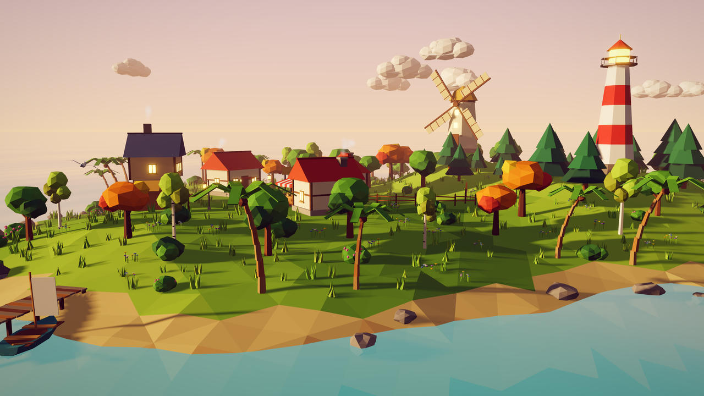

# Витрина: низкополигональные сцены и набор моделей

Пример `crates/engine/examples/showcase` показывает, на что способен рендер: набор из
54 низкополигональных моделей (плюс 4 меша земли и неба), построенный кодом, четыре сцены
со своим светом и настроением и облёт камерой. Всё — обычные ассеты: модели `.obj`,
материалы `.material`, префабы `.prefab`, сцены `.scene` открываются в редакторе.



## Запуск

```text
cargo run --example showcase                     # облёт в окне: 1…4 — сцена, пробел — пауза, Esc — выход
cargo run --example showcase -- --editor island  # сцена в редакторе (island | clearing | workshop | valley)
cargo run --example showcase -- --generate       # заново построить набор и сцены (те же байты)
cargo run --example showcase -- --render docs/renders --size 1920x1080 --ss 2 --contact
cargo run --example showcase -- --kit            # таблица моделей (ниже)
```

Снимок одной закладки без окна:

```text
SHOWCASE_SCENE=clearing SHOWCASE_SHOT=fox SHOWCASE_SIZE=2560x1440 SHOWCASE_SS=2 \
ENGINE_SCREENSHOT=fox.png cargo run --example showcase
```

`SHOWCASE_SS` (1…3) — сверхвыборка: кадр рисуется в N раз больше (с MSAA ×4) и
уменьшается фильтром Ланцоша. Перед снимком сцена живёт 120 кадров (`SHOWCASE_FRAMES`) —
дым, искры и светлячки успевают разлететься. `--render` берёт список `--shots
сцена:закладка,…` (по умолчанию — десять главных). Пример всегда без звука.

## Сцены

| файл | что показывает | закладки |
|---|---|---|
| `scenes/showcase/island.scene` | остров на закате: поле высот с плоскими гранями, вода, деревня с горящими окнами, мельница с вращающимися крыльями, маяк, пирс с лодкой, дым из труб, чайки; низкое солнце сбоку, `SkyColors` + `ColorGrading` | hero, village, windmill, lighthouse, aerial |
| `scenes/showcase/clearing.scene` | ночная поляна: костёр — главный свет (мерцающий точечный, угли, искры), лунный контровой свет с тенями, низовой туман (`Fog`), светлячки, светящиеся грибы, звёзды и луна | hero, fox, tent, owl, wide |
| `scenes/showcase/workshop.scene` | диорама-мастерская на чистом фоне: солнце только через окно, лампа и кристаллы — точечные источники, металл, свечение, стекло, пылинки в луче; герой — робот | hero, robot, bench, top |
| `scenes/showcase/valley.scene` | рельеф 2 × 2 км с горами (LOD, вода) и ~2300 деревьев-экземпляров | hero, forest, high |

Закладки — объекты `Shots/<имя>` с компонентом `Camera`; активна `hero`. В редакторе
включите другую и выключите `hero` — окно Game покажет этот вид.

Компоненты сцен (регистрирует пример, `tour.rs`): `Spin { axis, speed }` — вращение
(крылья мельницы, круги чаек), `Flicker { amount, speed }` — мерцание `Light` (костёр),
`Bob { height, roll, speed }` — качка (лодка). Общий редактор без примера покажет их как
«missing script» — открывайте сцены через `--editor`.

## Рендеры

`docs/renders/` (перерисовать — команда `--render` выше):

| файл | замысел |
|---|---|
| `island_hero_*` (1920, 2560, 3840) | вся деревня одним кадром: пирс с лодкой — ведущая линия слева внизу, мельница и маяк — силуэты на тёплом небе, солнце сбоку, длинные тени |
| `island_windmill_1920x1080` | мельница снизу против заката, крылья в движении |
| `island_village_1920x1080` | улица деревни на уровне глаз: прилавок, светящиеся окна, глубина |
| `clearing_hero_*` (1920, 2560) | лагерь у костра в ночном лесу: тёплый ключ против холодной луны |
| `clearing_fox_1920x1080` | лисёнок у огня, искры и блум |
| `clearing_owl_1920x1080` | сова на пне, светящиеся глаза, лес в темноте |
| `workshop_hero_*` (1920, 2560) | диорама целиком: свет из окна, кристаллы, лампа |
| `workshop_robot_1920x1080` | робот крупно, контровой свет окна |
| `valley_hero_*` (1920, 2560) | масштаб: леса до горизонта, горы, море |
| `valley_high_1920x1080` | вид сверху: LOD рельефа, туман дали |

`contact.png` — все кадры листом; `*.jpg` (1280 px, ≤ 150 КБ) — для README.

Кадр на GTX 1050 Ti без окна (рендер + чтение в память; «1920×1080 ×2» — это кадр
3840×2160 с MSAA ×4, уменьшаемый потом):

| закладка | draw calls (из них тени) | мешей в кадре | треугольников | мс/кадр 1920×1080 ×2 |
|---|---|---|---|---|
| island / hero | 79 (35) | 730 | 94 074 | 26 |
| clearing / hero | 55 (23) | 265 | 24 822 | 34 |
| workshop / hero | 47 (20) | 31 | 4 758 | 35 |
| valley / hero | 613 (142) | 2 299 | 578 898 | 89 |

У долины основную долю вызовов дают чанки рельефа; 2300 деревьев — по одному вызову на
модель (инстансинг). В 640×360 без сверхвыборки те же кадры — 2.3…9 мс.

## Набор моделей

Генератор — модули примера: `geo.rs` (примитивы с плоскими гранями: коробка, тело
вращения, конус, «камень» из икосаэдра с шумом, двускатная крыша, оболочка по сечениям),
`palette.rs` (палитра), `kit.rs` (модели), `ground.rs` (остров, поляна, диорама, ночное
небо), `scenes.rs` (расстановка и запись сцен). Генератор детерминирован: один код — одни
байты (это проверяет тест `crates/engine/tests/showcase.rs`).

* **Палитра** — `showcase/palette.png`, 256 × 256: квадраты 16 × 16 по одному цвету (~130
  цветов, фильтр `Nearest`). UV каждой грани — центр квадрата её цвета.
* **Четыре общих материала** на всю палитру: `showcase/materials/kit` (матовый),
  `glow` (свечение палитрой ×4 — окна, огонь, кристаллы, глаза; тени не отбрасывает),
  `metal` (металл 0.6, шероховатость 0.38), `glass` (полупрозрачное стекло). Модель —
  `.obj` с частями `usemtl kit | glow | metal | glass`; префаб `showcase/prefabs/<имя>.prefab`
  назначает материалы по частям. Все модели делят 4 группы привязок, а одинаковые модели
  рисуются одним вызовом с любым `tint` (оттенок экземпляра — переопределение префаба).
* **Бюджеты** — ступени 64 / 128 / 192 / 256 / 384 / 512 / 640 треугольников; модель не
  может их превысить (тест).
* Сцена хранит экземпляры префабов одной строкой каждый, поэтому даже долина с тысячами
  деревьев читается и открывается в редакторе.

| модель | тема | треугольников | бюджет |
|---|---|---|---|
| `pine` | nature | 62 | 64 |
| `pine_small` | nature | 44 | 64 |
| `pine_snow` | nature | 146 | 192 |
| `tree_round` | nature | 244 | 256 |
| `tree_autumn` | nature | 224 | 256 |
| `birch` | nature | 388 | 512 |
| `palm` | nature | 308 | 384 |
| `bush` | nature | 180 | 192 |
| `bush_berry` | nature | 340 | 384 |
| `rock_small` | nature | 80 | 128 |
| `rock_large` | nature | 120 | 128 |
| `cliff` | nature | 280 | 384 |
| `grass_tuft` | nature | 42 | 64 |
| `flowers` | nature | 384 | 384 |
| `mushroom` | nature | 120 | 128 |
| `mushroom_cluster` | nature | 192 | 192 |
| `glow_shrooms` | nature | 144 | 192 |
| `log` | nature | 92 | 128 |
| `stump` | nature | 104 | 128 |
| `cloud` | nature | 420 | 512 |
| `cottage` | settlement | 404 | 512 |
| `cottage_tall` | settlement | 508 | 512 |
| `windmill` | settlement | 232 | 256 |
| `windmill_sails` | settlement | 320 | 384 |
| `well` | settlement | 192 | 192 |
| `fence` | settlement | 64 | 64 |
| `bridge` | settlement | 464 | 512 |
| `lantern_post` | settlement | 116 | 128 |
| `market_stall` | settlement | 636 | 640 |
| `cart` | settlement | 244 | 256 |
| `boat` | settlement | 148 | 192 |
| `pier` | settlement | 480 | 512 |
| `lighthouse` | settlement | 472 | 512 |
| `crate` | props | 156 | 192 |
| `barrel` | props | 180 | 192 |
| `campfire` | props | 388 | 512 |
| `tent` | props | 104 | 128 |
| `signpost` | props | 48 | 64 |
| `bench` | props | 84 | 128 |
| `firewood` | props | 432 | 512 |
| `sack` | props | 128 | 128 |
| `fox` | creatures | 494 | 512 |
| `gull` | creatures | 66 | 128 |
| `owl` | creatures | 410 | 512 |
| `workbench` | workshop | 128 | 128 |
| `shelf` | workshop | 364 | 384 |
| `desk_lamp` | workshop | 136 | 192 |
| `toolbox` | workshop | 72 | 128 |
| `gear` | workshop | 384 | 384 |
| `crystal` | workshop | 164 | 192 |
| `terminal` | workshop | 72 | 128 |
| `jar` | workshop | 104 | 128 |
| `plant_pot` | workshop | 150 | 192 |
| `robot` | workshop | 592 | 640 |
| `island` | ground | 3872 | 4000 |
| `clearing` | ground | 2592 | 2700 |
| `diorama` | ground | 432 | 700 |
| `night_sky` | ground | 220 | 700 |

Всего: 19966 треугольников.

Робот `rover` из образцов Piska Modeler (`models/rover.pmodel`) тоже стоит в мастерской —
пиксельная текстура рядом с палитрой.

## Новое в рендере: `SkyColors` и `ColorGrading`

Два необязательных компонента сцены (как `Fog`: на любом объекте, действует первый
активный; без них кадр как раньше). Оба — в `engine::prelude`, в редакторе — в разделе
Rendering меню Add Component.

```rust
use engine::prelude::*;

// Лунная ночь: тени от «луны» (направленный свет высоко), но небо не дневное.
app.spawn("Lighting")
    .with(SkyColors {
        zenith: Color::rgb(0.006, 0.012, 0.04),
        horizon: Color::rgb(0.03, 0.05, 0.1),
        ..SkyColors::default()
    })
    .with(ColorGrading {
        contrast: 1.12,
        saturation: 1.05,
        shadows: Color::rgb(0.1, 0.22, 0.5), // холодные тени
        ..ColorGrading::default()
    });
```

* `SkyColors { enabled, zenith, horizon, blend }` — цвета неба (линейные) вместо
  вычисленных по высоте солнца; `blend` 0.5 — пополам с вычисленными. От них же рассеянный
  свет, отражения неба и цвет тумана.
* `ColorGrading { enabled, temperature, tint, contrast, saturation, shadows, highlights }`
  — баланс белого (до тонмаппинга, средняя яркость сохраняется), контраст и насыщенность
  вокруг среднего серого, тонирование теней (`shadows` — подмешиваемый цвет) и множитель
  светов (`highlights`). `ColorGrading::warm()` — готовый «закат». Действует на вид из
  камеры сцены (игра, окно Game, снимки); превью материалов в редакторе — без него.

Чего рендеру ещё не хватает для таких сцен (не сделано): второго направленного света
(заполняющий без теней), мягких теней шире PCF 3 × 3, теней от точечных источников (костёр
не даёт теней), отражений в воде (только небо по Френелю), глубины резкости.
